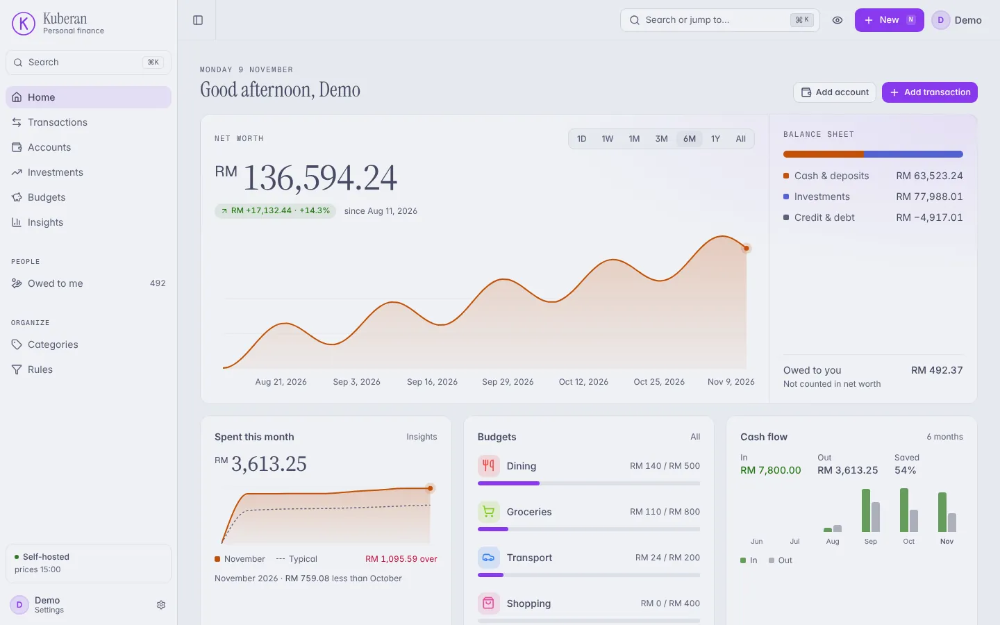
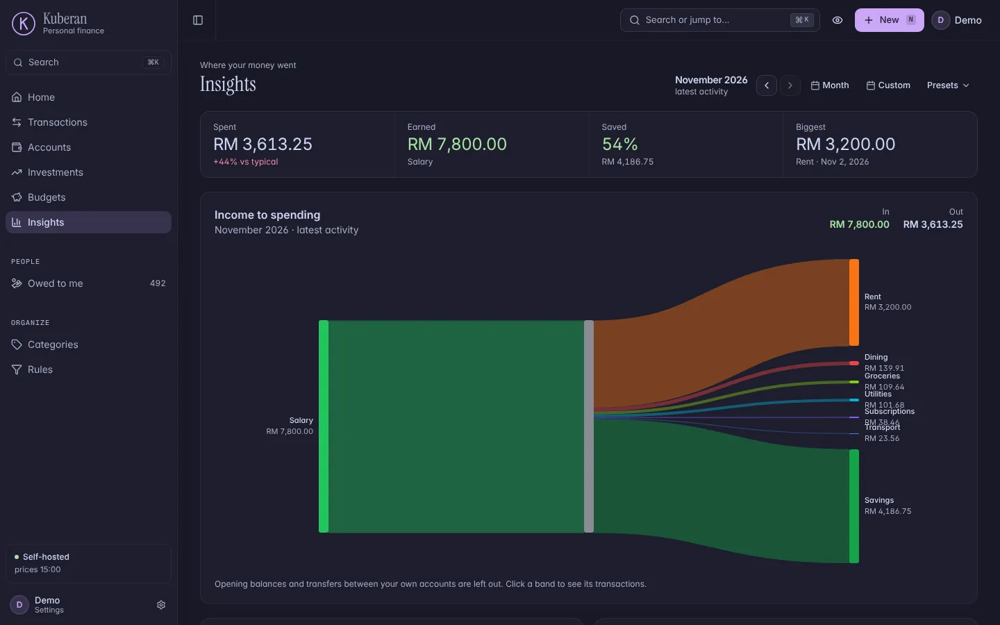
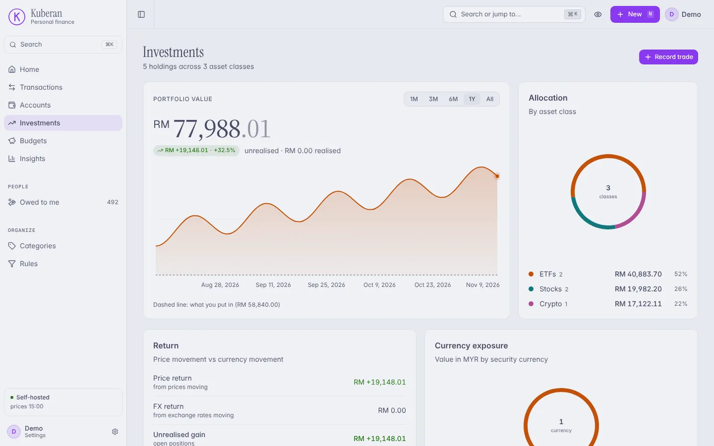
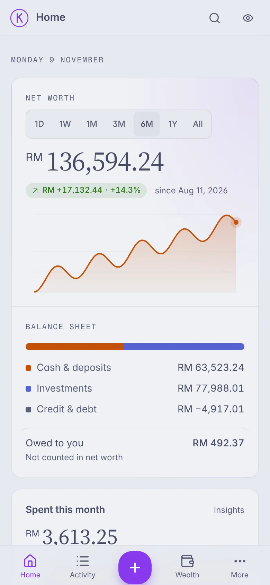
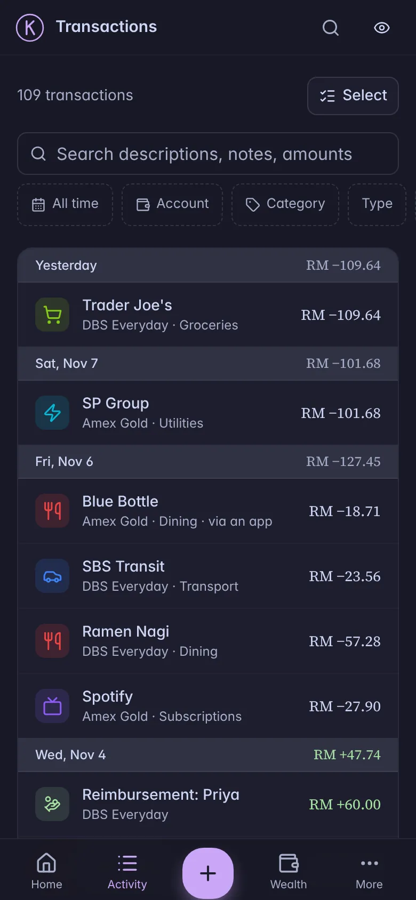

<p align="center">
  
</p>

<h1 align="center">Kuberan</h1>

<p align="center">
  Self-hosted personal finance: accounts, budgets and investments in one place you run yourself.<br>
  Ask Claude about your money, or log an expense from Telegram. Your data stays in your own database.
</p>

<p align="center">
  <a href="docs/self-hosting.md">Self-hosting</a> ·
  <a href="docs/connect-ai-assistant.md">Connect Claude</a> ·
  <a href="docs/telegram-bot.md">Telegram bot</a> ·
  <a href="#development">Development</a> ·
  <a href="#documentation">Docs</a>
</p>

<p align="center">
  <picture>
    <source media="(prefers-color-scheme: dark)" srcset="apps/site/img/dashboard-dark.webp">
    
  </picture>
</p>

Named after Kubera, the Hindu god of wealth. No bank logins, no ads, no third party holding your data: Kuberan
runs on your own server (or your own Supabase project), and everything it knows can be exported as CSV at any time.

## Features

**Everyday money**

- Cash, credit-card, loan, fixed-deposit and investment accounts, each in its own currency
- Income, expenses and transfers (including between currencies), with notes, receipts and shared expenses
- Fast search across descriptions, notes and amounts; filters; bulk recategorise and delete
- Rules that categorise new transactions automatically, with match counts and suggestions
- Budgets with pace tracking, money owed to you, and due-date reminders for cards, loans and deposits
- Bank-statement CSV import and Interactive Brokers activity-statement import

**Investing**

- Holdings, buys, sells, dividends (with withholding) and splits, with realised and unrealised gains
- Multi-currency done properly: trades keep the rate they happened at, and returns split into price and FX
- Daily prices and exchange rates from the price oracle, portfolio and net-worth history

**Insights**

- Net worth over time, a balance sheet, and where your money went this month
- Spending against your typical month, by category, by day and as an income-to-spending flow

**Assistants**

- **Claude** through MCP: ask about balances, spending, budgets or your portfolio, and (if you allow it) let it
  record transactions. Every app's access is scoped, rate-limited, audited and revocable from Settings.
- **Telegram**: type `coffee 18.40`, confirm, done. `/spent`, `/balance`, `/budgets`, `/undo`, receipt photos and
  due-date reminders.

**Your data**

- Self-hosted on Docker Compose with Postgres, or on Supabase
- Full CSV export, nightly encrypted off-site backups, an audit log of every sensitive change
- Eight colour palettes, light and dark, installable as an app on your phone

## Screenshots

<table>
  <tr>
    <td width="50%"></td>
    <td width="50%"></td>
  </tr>
  <tr>
    <td align="center">Insights</td>
    <td align="center">Investments</td>
  </tr>
</table>

<p align="center">
  
  &nbsp;&nbsp;
  
</p>

## Getting started

You need a machine with Docker Compose. Postgres is included, or you can point Kuberan at a Supabase project.

```bash
git clone https://github.com/zihangg/kuberan && cd kuberan
cp .env.prod.example .env.prod   # fill in your secrets and domain
./deploy/deploy.sh
```

`deploy.sh` builds the images, takes a pre-migration backup, runs database migrations and starts everything once
it is healthy; if a step fails it prints how to roll back. Read **[docs/self-hosting.md](docs/self-hosting.md)**
first: it walks through every required setting, TLS, upgrades and backups. Upgrading later is the same command.

## How it fits together

```
                        ┌──────────────┐
  Browser / phone ────▶ │  web         │  Next.js app
                        └──────┬───────┘
                               ▼
  Telegram ──▶ bot ───▶ ┌──────────────┐ ◀─── oracle (prices, FX rates, snapshots; every 30 min)
                        │  api         │
  Claude ──▶ mcp ─────▶ │  Go + Gin    │ ───▶ Postgres (or Supabase)
     ▲                  └──────────────┘ ───▶ MinIO / S3 (receipts)
     └── OAuth 2.1 ── Ory Hydra                backup ──▶ pg_dump + encrypted off-site copy
```

| App | What it is |
|---|---|
| [`apps/api`](apps/api) | Go API (Gin, GORM, Postgres 16, golang-migrate). Also builds the MCP server (`cmd/mcp`), an OAuth 2.1 resource server in front of the same services. |
| [`apps/web`](apps/web) | Next.js 15 / React 19 web app (Tailwind CSS v4, shadcn/ui, TanStack Query). |
| [`apps/bot`](apps/bot) | Python Telegram bot; talks to the API over HTTP as the linked user. |
| [`apps/oracle`](apps/oracle) | Go worker that publishes security prices and FX rates and triggers daily snapshots. |
| [`apps/backup`](apps/backup) | Scheduled `pg_dump` with retention, plus client-side-encrypted replication to Cloudflare R2. |
| [`apps/site`](apps/site) | Static landing page (deployed separately; never served by an instance). |

Design notes worth knowing before you change anything:

- **Money is int64 cents**, never floats, and every amount carries its currency. Totals across currencies are
  converted to your reporting currency and never assume a 1:1 rate (see [docs/multi-currency.md](docs/multi-currency.md)).
- **Handlers → services → models.** Services are interfaces; every query is scoped to the signed-in user; every
  balance change happens in one database transaction; sensitive operations are audited.
- **Schema changes are SQL migrations** in `apps/api/migrations`, never GORM AutoMigrate.

[`CLAUDE.md`](CLAUDE.md) is the full reference: conventions, every endpoint and every environment variable.

## Development

Prerequisites: Docker, Go 1.26, Node 20 with pnpm 10, Python 3.12.

```bash
npm run dev          # api, web, mcp, hydra and postgres with hot reload
npm run dev:bot      # the same, plus the Telegram bot
```

| Service | URL |
|---|---|
| Web app | http://localhost:3000 |
| API | http://localhost:8080 (Swagger UI at `/swagger/index.html`) |
| MCP server | http://localhost:8081 |
| Ory Hydra | http://localhost:4444 |
| Postgres | `localhost:5433` |

Or run pieces on their own: `cd apps/api && air` for the API, `cd apps/web && pnpm dev` for the web app.

### Checks

Every change runs through these in CI:

```bash
./scripts/check-go.sh apps/api       # build, vet, golangci-lint, tests, race detector
./scripts/check-go.sh apps/oracle
cd apps/web && pnpm lint && pnpm exec tsc --noEmit && pnpm test && pnpm build
cd apps/bot && pytest -q
```

End-to-end tests drive the real web app against a real API and Postgres
([docs/e2e.md](docs/e2e.md)): `cd apps/web && pnpm e2e`.

### Common tasks

```bash
cd apps/api && go run cmd/migrate/main.go up        # apply migrations (down 1 to step back)
cd apps/api && swag init -g cmd/api/main.go -d . --output internal/docs --parseDependency   # regenerate Swagger
cd apps/web && pnpm screenshots --email … --password …  # every route, light and dark (docs/screenshots.md)
```

## Documentation

| Guide | |
|---|---|
| [Self-hosting](docs/self-hosting.md) | Install, configure, upgrade |
| [Database setup](docs/database-setup.md) | Bundled Postgres or Supabase |
| [Backups and disaster recovery](docs/backup-and-dr.md) | Backups, off-site copies, restores, upgrade notes |
| [Connect an AI assistant](docs/connect-ai-assistant.md) | Adding Kuberan to Claude, permissions and limits |
| [MCP and OAuth](docs/mcp-oauth.md) | How the MCP server and Hydra fit together |
| [Telegram bot](docs/telegram-bot.md) | Setup, linking and every command |
| [Multi-currency](docs/multi-currency.md) | How amounts, rates and totals work |
| [CSV import](docs/csv-import.md) · [IBKR import](docs/ibkr-import.md) | Importing statements |
| [Receipts](docs/receipts.md) | Attachment storage and limits |
| [End-to-end tests](docs/e2e.md) · [Screenshots](docs/screenshots.md) | Testing tools |
| [Public demo](docs/public-demo.md) | Optional demo instance with a nightly reset |

Design history and upcoming work live in [`plans/`](plans).

## License

Private project. All rights reserved.
