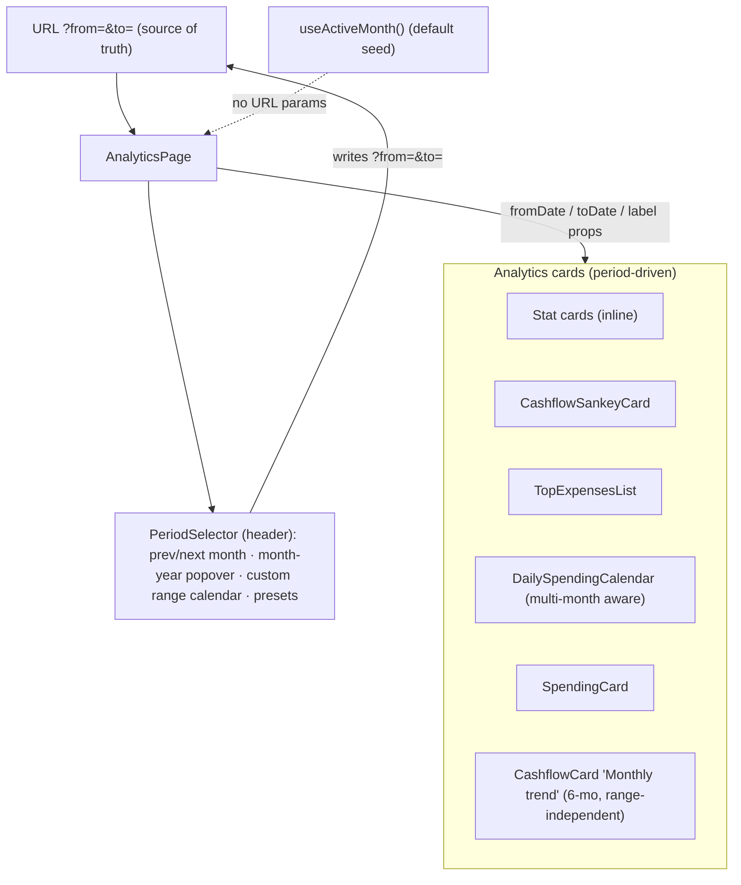

# Plan 019 - Analytics Period Selector (month + custom range)

## Context

The analytics page (`apps/web/src/app/(dashboard)/analytics/page.tsx`) only ever shows **one** period,
and the user can't choose it. The period is *derived*, not *selected*: every card resolves its own
window via `useActiveMonth()` (`apps/web/src/hooks/use-active-month.ts`), which picks the latest month
that has spending (to survive backfilled/imported data), falling back to the real calendar month.

The user wants to pick **which month** to view, and to enter an **arbitrary custom date range**.

Key finding from the investigation: **the backend is already range-agnostic.** Every endpoint these
cards use (`spending-by-category`, `cashflow`, `daily-summary`, `top-expenses`) accepts free
`from_date`/`to_date` query params (`apps/web/src/hooks/use-transactions.ts:169-243`). So this is a
**frontend-only** change: shared period state + a selector UI + threading the window into the cards.
No API, service, or migration work.



## Decisions (confirmed with user)

1. **Capability**: month navigation **and** arbitrary custom date range, **plus quick presets**
   (This month, Last month, Last 3 months, Year to date). Presets write a concrete `from`/`to`, so
   they are just shortcuts over the same range state - no special-casing downstream.
2. **Daily-activity card adapts to multi-month spans** (see Section 4) rather than silently showing
   only the first month.
3. This document is the plan; implementation follows after review.

## Architecture

### State ownership and flow

- **The analytics page owns the selected period.** It is the single place that reads/writes the
  selection. Cards stay dumb and receive `{ fromDate, toDate, label }` as props.
- **URL is the source of truth** (`?from=YYYY-MM-DD&to=YYYY-MM-DD`). Rationale: survives reload, is
  shareable/bookmarkable, and the app already uses `useSearchParams` (`app/(oauth)/.../page.tsx`).
  Dates are stored as **local calendar dates** (`YYYY-MM-DD`), not ISO instants, to avoid the
  timezone-shift class of bug the daily calendar already warns about
  (`daily-spending-calendar.tsx:18-24`). The hooks convert to UTC day bounds at call time via the
  existing `localDayStartUTC` / `localDayEndUTC` (`use-transactions.ts:176,186,...`).
- **Default when no URL params**: seed from `useActiveMonth()` - preserving today's "latest activity"
  behavior as the landing view. We do **not** redirect/rewrite the URL on load (keeps the default
  dynamic and the URL clean); params appear only once the user picks something.

### New hook: `useAnalyticsPeriod()`

`apps/web/src/hooks/use-analytics-period.ts` - encapsulates reading the URL, falling back to
`useActiveMonth()`, and producing the derived window + a human label. Returns:

```ts
interface AnalyticsPeriod {
  fromDate: string;   // local YYYY-MM-DD, inclusive
  toDate: string;     // local YYYY-MM-DD, inclusive
  label: string;      // "October 2026" | "Oct 1 - Oct 15, 2026" | "Last 3 months"
  mode: "month" | "range";
  isActiveMonthDefault: boolean; // true when no URL params (showing latest-activity default)
  monthCount: number; // number of calendar months the range spans (>=1); drives the daily card
  setMonth(year: number, monthIndex: number): void;
  setRange(from: string, to: string): void;
  isLoading: boolean; // from useActiveMonth while default is resolving
}
```

Writes go through `router.replace` with updated `searchParams` (replace, not push, so the back button
doesn't walk every tweak). `label` logic: single full calendar month -> `"October 2026"`; otherwise
`"Oct 1 - Nov 15, 2026"`. `mode` is `"month"` when the range is exactly one whole calendar month,
else `"range"` (this is what the month picker vs. the calendar reflect).

### Why props with fallback (not a context / not editing `useActiveMonth`)

`SpendingCard` and `CashflowCard` are **also rendered on the dashboard home**
(`app/(dashboard)/page.tsx:228-229`), which must keep auto-resolving the active month. So:

- Add **optional** `fromDate?`, `toDate?`, `label?`, `isActiveMonthDefault?` props to
  `SpendingCard`, `CashflowCard`, `CashflowSankeyCard`.
- When the period props are **absent**, each card falls back to its current `useActiveMonth()` call
  (dashboard home: unchanged behavior).
- When **present** (analytics page), the card uses them and skips its own resolution.

This keeps the data dependency explicit (project preference: explicit/robust over implicit magic),
avoids a route-scoped context provider, and leaves `useActiveMonth` untouched for all other callers.

> Implementation note: to avoid calling `useActiveMonth()` needlessly inside a card when props are
> supplied, the cleanest shape is a tiny internal resolver, e.g.
> `const period = useCardPeriod(props)` that returns props-or-active-month. The hook still runs
> unconditionally (Rules of Hooks); it just ignores its result when props win. Acceptable - the query
> is cached and cheap. Alternatively, split each card into a thin prop-taking inner component and an
> active-month wrapper; decide at implementation time, preferring the smaller diff unless it reads
> badly.

## Work breakdown

### 1. Period hook + URL state
- `hooks/use-analytics-period.ts` (new) as specified above.
- Pure helpers (month range, whole-month detection, label formatting, month-count) live alongside or
  in `lib/format.ts` if they're generically useful. Reuse `monthRange` logic from
  `use-active-month.ts` - extract a shared helper rather than duplicating.

### 2. PeriodSelector component
- `components/analytics/period-selector.tsx` (new). Sits in the page header next to the title.
- Controls:
  - **Prev / next month** chevrons (disabled/cosmetic when in free-range mode, or they snap to
    month mode on the adjacent month).
  - **Month-year picker**: a `popover` with a compact year stepper + 12-month grid. Uses existing
    `popover` + `button`. No new dependency.
  - **Custom range**: a `popover` containing a **range calendar**. This needs the shadcn `calendar`
    component, which is **not yet installed** - see Section 3.
  - **Presets**: `dropdown-menu` or inline buttons - This month, Last month, Last 3 months, YTD.
- Shows the current `label`. When `isActiveMonthDefault`, append the existing
  `"· latest activity"` hint (match current wording in the cards/page).

### 3. New dependency: calendar primitive (custom range)
- There is **no `calendar` UI primitive** today and **no `react-day-picker` / `date-fns`** installed
  (confirmed via `package.json`).
- Add the shadcn `calendar` component (`components/ui/calendar.tsx`) + `react-day-picker` in
  **range** mode. shadcn's calendar uses `date-fns` transitively; pin versions compatible with
  React 19 / the installed Radix set. Keep styling consistent with the `new-york` theme and dark-first
  palette.
- Scope the dependency strictly to the range picker; the month picker must not require it.

### 4. DailySpendingCalendar: multi-month spans
- Today it builds a single month grid from `fromDate`'s month
  (`daily-spending-calendar.tsx:49-66`) - a multi-month range would silently show only the first month.
- Change: when `monthCount > 1`, render **one month grid per calendar month in the range**, stacked
  with a month sub-heading each, iterating months from `fromDate` to `toDate`. Each grid filters the
  same `useDailySummary(fromDate, toDate)` data by that month (data already keyed by `YYYY-MM-DD`).
  Partial end months render only the in-range days as active; out-of-range days render muted.
- Keep the single-month path visually identical to today when `monthCount === 1`.
- Update the card description to reflect the range ("Income and expenses by day" without the hardcoded
  "this month" when `mode === "range"`).

### 5. Wire the page
- `analytics/page.tsx`: call `useAnalyticsPeriod()`, render `<PeriodSelector/>` in the header, pass
  `{ fromDate, toDate, label, isActiveMonthDefault }` to `CashflowSankeyCard`, `SpendingCard`,
  `CashflowCard`, `TopExpensesList`, `DailySpendingCalendar`, and the stat-card queries.
- `CashflowCard` ("Monthly trend") is a fixed 6-month `useMonthlySummary(6)` trend and is **not**
  range-bound; it keeps showing the 6-month trend. Decide its header label: show the selected period's
  label for consistency, or relabel to "Last 6 months" to avoid implying it's filtered. **Recommend
  relabeling its description to "Last 6 months"** so it doesn't look mis-scoped against a custom range.

### 6. Cards: optional period props + fallback
- `SpendingCard`, `CashflowCard`, `CashflowSankeyCard`: add optional period props; fall back to
  `useActiveMonth()` when absent (Section "Why props with fallback"). Dashboard home call sites
  (`app/(dashboard)/page.tsx`) stay as-is (no props -> unchanged).

## Edge cases & correctness

- **Invalid / malformed URL params** (`from > to`, non-dates, future dates): the hook sanitizes -
  swap if reversed, drop to the active-month default if unparseable. Never throw.
- **Timezone**: store local `YYYY-MM-DD`; only convert to UTC bounds inside the query hooks (existing
  `localDayStartUTC`/`localDayEndUTC`). This sidesteps the month-shift bug the calendar file documents.
- **Empty periods**: cards already handle empty data ("No expenses recorded", "No income or expenses
  recorded for this period") - a user-chosen empty month must hit those states, not a spinner.
- **`isCurrentMonth` / "latest activity" hint**: today several cards print `"· latest activity"` when
  not the current calendar month. With explicit selection that hint is misleading. Replace with:
  show the hint **only** when `isActiveMonthDefault` is true (i.e. the unselected default). Once the
  user picks a period, show just the label.
- **React Query caching**: query keys already include `from`/`to`
  (`transactionKeys.spendingByCategory(from,to)` etc.), so switching periods caches per-window and
  revisiting is instant. No key changes needed.
- **Presets vs. "This month"**: "This month" = real calendar month (may be empty if data is
  backfilled) - that's correct and intended; it differs from the latest-activity default.

## Out of scope
- Backend changes (none needed).
- Comparing two periods side by side.
- Persisting a per-user default period server-side.
- Applying the selector to the dashboard home (home keeps latest-activity auto-resolution).

## Verification
- `cd apps/web && pnpm lint && pnpm build` (strict TS, no `any`).
- Manual E2E (as a user would): pick a prior month, a custom cross-month range, each preset; confirm
  every card + stat updates, empty months show empty states, URL reflects selection, reload restores
  it, back button behaves, and the dashboard home is visually unchanged.
- Pixel check the selector in dark and light themes and at mobile widths (project UI bar).

## Files
**New**
- `apps/web/src/hooks/use-analytics-period.ts`
- `apps/web/src/components/analytics/period-selector.tsx`
- `apps/web/src/components/ui/calendar.tsx` (shadcn) + `react-day-picker` dep

**Changed**
- `apps/web/src/app/(dashboard)/analytics/page.tsx`
- `apps/web/src/components/analytics/daily-spending-calendar.tsx`
- `apps/web/src/components/dashboard/spending-card.tsx`
- `apps/web/src/components/dashboard/cashflow-card.tsx`
- `apps/web/src/components/analytics/cashflow-sankey-card.tsx`
- `apps/web/src/hooks/use-active-month.ts` (extract shared month-range helper; no behavior change)
