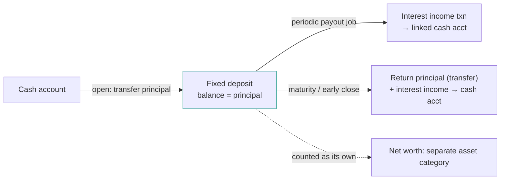
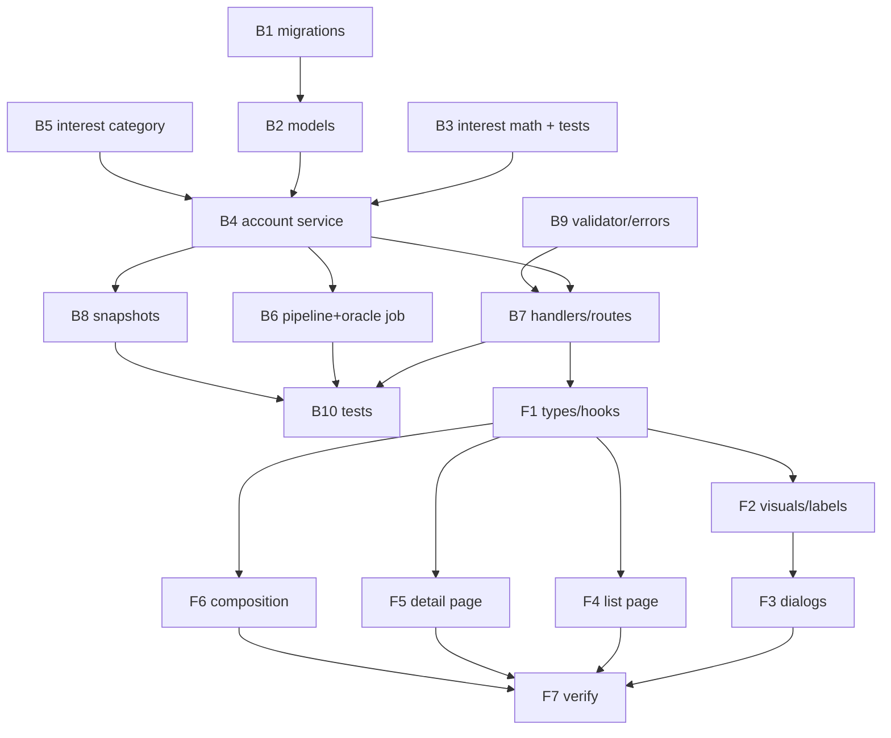

# Plan 020 — Fixed Deposit Accounts

## Context

Kuberan supports four account types — `cash`, `investment`, `credit_card`, `debt` — wired through a
consistent set of touchpoints (model, validator, service, handlers, routes, snapshots, and the web
type/visual/hook/dialog/page stack). This plan adds a fifth, **`fixed_deposit`**: an asset account
representing a term deposit (principal locked at a fixed rate until a maturity date).

A fixed deposit differs from the existing types because it is **time-based**: it is opened by moving
principal out of a bank account, earns interest at a fixed rate over a term, and is realized (with
interest) either periodically or in a lump at maturity. The plan confines that time-based complexity
to (a) a small, heavily tested interest-math helper and (b) one scheduled processing job, keeping the
account's balance semantics identical to cash.

### Locked product decisions (from review, 2026-10-18)

| Topic | Decision |
|---|---|
| Valuation | **Static principal.** Balance always equals principal. Projected maturity value is stored metadata, not balance. Net worth never reflects unrealized interest. |
| Interest payout | **User-selectable per FD: `cumulative` (lump at maturity) or `periodic` (monthly/quarterly/etc. to a linked cash account).** |
| Maturity | **Manual with notification.** System flags a matured FD and surfaces a "Record payout" CTA; it never auto-moves money. |
| Net worth | **Separate asset category** ("Fixed deposits") in accounts page + composition card + a dedicated snapshot column. |
| Funding | **Opening an FD deducts principal from a chosen bank (cash) account** via the existing transfer path. |
| Interest category | **Auto-provision a shared per-user "Interest Income" category** (income type) used for periodic payouts and the interest leg of a realization. |
| Premature withdrawal | **In scope.** A single "close deposit" action handles both maturity and early close; it computes a suggested realized amount (accrued interest, optional penalty) that the user can adjust. |

## Findings that shape the design

1. **`accounts.type` is gated only by `validateAccountType` (`validator/validator.go:86`); there is no
   DB CHECK constraint** on the column (`migrations/000002_create_accounts.up.sql`). Adding a type is a
   code change, not a schema change, on the `accounts` table itself.

2. **Type-specific fields are currently inline columns on `accounts`** (`broker`, `account_number`,
   `interest_rate`, `due_date`, `credit_limit`) with a `BeforeCreate` hook nulling the irrelevant ones
   (`models/account.go:45`). FD needs ~9 more fields — enough that continuing the inline pattern would
   bloat `accounts` with columns relevant to one type. **Decision D1: use a dedicated 1:1
   `fixed_deposit_details` table**, reusing the existing `accounts.interest_rate` column for the rate.

3. **Balance-sign inversion is credit-card-only** (`account_service.go` income/expense switch; transfer
   balance-check exemption at `transaction_service.go:153`). FD is a normal asset — **no inversion**,
   same semantics as cash. No change needed to those switches beyond leaving FD on the default branch.

4. **Net worth is computed in two places that must agree**: the backend snapshot
   (`portfolio_snapshot_service.go:66` — `cash + investment − (debt+credit_card)`) and the frontend
   accounts page / composition card. FD adds a new asset term in all of them, plus a new
   `fixed_deposit_balance` column on `portfolio_snapshots`.

5. **The oracle is a run-to-completion job** (`apps/oracle/main.go`) invoked on a cron that calls
   pipeline endpoints (e.g. snapshot computation). This is the right home for FD scheduled processing:
   add a pipeline endpoint and have the oracle call it each run. No new long-running scheduler needed.

6. **Cash account creation already conjures an opening balance** via an initial income transaction
   (`CreateCashAccount`). FD will instead fund from a chosen cash account via the existing **transfer**
   service, which already enforces sufficient balance — a cleaner, more honest money movement.

7. **`debt` is a half-wired cautionary precedent**: model + validator + snapshot math exist, but it has
   no create endpoint, hook, or UI. FD must be wired **end-to-end** so it does not land in that state.

8. **Next free migration number is `000028`.**

## Interest math (the correctness core)

A single pure package (`internal/services/fixeddeposit` or a `fdmath` helper file) with no DB
dependency, exhaustively unit-tested. All money `int64` cents; rates are annual decimals
(`interest_rate` is a percent float today, e.g. `3.5` → `0.035`).

- **Day count:** actual/365-fixed. Documented decision; simple and deterministic.
- **Term** `t` = `(maturity_date − start_date)` in years (days/365).
- **Cumulative maturity value:** compound at the configured compounding frequency `n`
  (`compounding` enum → periods/year): `MV = round(P · (1 + r/n)^(n·t))`.
- **Periodic payout per period:** `interest_per_period = round(P · r / periodsPerYear)` where
  `periodsPerYear` derives from `payout_frequency`. Principal is returned only at close/maturity.
- **Accrued-to-date (suggestion for early close / display):** simple pro-rata
  `accrued = round(P · r · daysElapsed/365)`. Used to pre-fill the close dialog; user-adjustable.
- **Rounding:** nearest cent, banker's or half-up — pick one, document, test boundary cases.

Unit tests must cover: zero rate, sub-year term, multi-year term, each compounding/frequency enum,
leap-year spans, and rounding boundaries.

## Data model

### `fixed_deposit_details` (new, 1:1 with `accounts`)

| column | type | notes |
|---|---|---|
| `account_id` | uuid FK → accounts, unique, not null | 1:1; cascade on account soft-delete |
| `principal` | bigint (cents) | = opening balance |
| `start_date` | date | |
| `maturity_date` | date | `> start_date` (validated) |
| `payout_type` | varchar | `cumulative` \| `periodic` (CHECK) |
| `payout_frequency` | varchar null | `monthly\|quarterly\|semiannual\|annual`; required ⇔ periodic |
| `compounding` | varchar | periods/year basis for cumulative MV |
| `linked_account_id` | uuid FK → accounts, null | cash acct for periodic payouts + default realization destination |
| `next_payout_date` | date null | drives + guards the periodic job (idempotency) |
| `maturity_value` | bigint (cents) | computed/stored at create (and on rate/term edit) |
| `status` | varchar | `active\|matured\|closed` (CHECK) |

Rate lives on `accounts.interest_rate` (reused). Balance lives on `accounts.balance` (= principal
while active, `0` once closed).

### `portfolio_snapshots`

Add `fixed_deposit_balance bigint NOT NULL DEFAULT 0`. Historical rows default to 0 (no backfill
needed; FD did not exist before).

## Backend work plan (`apps/api`)

### B1 — Migrations
- `000028_create_fixed_deposit_details.{up,down}.sql`: the table above with FK + unique(`account_id`)
  + CHECKs on `payout_type`/`status`/`payout_frequency`. Down drops the table.
- `000029_add_fixed_deposit_balance_to_snapshots.{up,down}.sql`: add/drop the snapshot column.
- Optionally add a CHECK on `accounts.type` to include all five types — **deferred** (out of scope;
  the column has never had one and adding it risks existing rows; validator remains the gate).

### B2 — Models
- `models/account.go`: add `AccountTypeFixedDeposit = "fixed_deposit"`; extend `BeforeCreate` to null
  non-FD inline fields for the new type (it keeps `interest_rate`, clears broker/account_number/etc.).
- New `models/fixed_deposit.go`: `FixedDepositDetails` struct + enums (`PayoutType`, `PayoutFrequency`,
  `Compounding`, `FixedDepositStatus`) + relation on `Account` (`FixedDeposit *FixedDepositDetails`).

### B3 — Interest math package (+ tests)
As specified in "Interest math". Land this first with full unit coverage; everything else depends on it.

### B4 — Account service (`services/account_service.go`, `interfaces.go`)
- `CreateFixedDepositAccount(userID, req)`:
  1. Validate `source_account_id` is the user's active cash account with `balance ≥ principal`.
  2. In one DB transaction: create the FD account (`balance = 0`), create `fixed_deposit_details`
     (compute `maturity_value`, set `next_payout_date` if periodic, `status = active`), then **transfer
     principal** from source → FD via the transfer service (brings FD balance to principal and debits
     the bank). Reuse, don't duplicate, transfer logic.
- `UpdateFixedDepositAccount` / extend update path: allow editing mutable fields (rate, maturity_date,
  payout settings, linked_account); recompute `maturity_value` on change. `principal`/`start_date`
  immutable after creation.
- `CloseFixedDeposit(userID, accountID, req)` — handles **both** maturity realization and premature
  withdrawal:
  - Compute suggested amounts: principal + interest. For cumulative-at-maturity use stored
    `maturity_value`; for early close use accrued-to-date; apply optional `penalty` (cents).
  - Accept a caller override for the final interest/penalty (user-adjustable in UI).
  - In one transaction: transfer `principal` FD → destination cash account (FD balance → 0); post an
    **income** transaction for the net interest to the destination account, categorized to the
    auto-provisioned "Interest Income" category; set `status = closed`; optionally set FD
    `is_active = false`.
- Snapshot-safe: closed FD has balance 0 so it naturally drops out of the FD asset sum.

### B5 — Interest category provisioning
- Helper (in category service) `EnsureInterestIncomeCategory(userID)` returning the user's income
  "Interest Income" category, creating it idempotently if absent. Called by the payout/close paths.

### B6 — Scheduled processing (pipeline + oracle)
- New service method `ProcessFixedDeposits(asOf)` iterating active FDs across users:
  - **Periodic payout:** when `next_payout_date ≤ asOf`, post interest income to `linked_account_id`
    (categorized Interest Income) and advance `next_payout_date` by one period — **atomically**, so a
    re-run the same day cannot double-post (idempotency keyed on `next_payout_date`).
  - **Maturity flip:** when `maturity_date ≤ asOf` and `status = active`, set `status = matured`
    (no money movement — realization stays manual per the locked decision).
- Pipeline endpoint `POST /api/v1/pipeline/fixed-deposits/process` (X-API-Key), thin wrapper over the
  service, returning counts.
- Oracle: add a client call + config flag (mirror `ComputeSnapshots`) so each oracle run also
  processes FDs. Add oracle test.

### B7 — Handlers & routes (`handlers/account_handler.go`, `cmd/api/main.go`)
- `CreateFixedDepositAccountRequest` DTO: name, description, currency, `source_account_id`,
  `principal`, `interest_rate`, `start_date`, `maturity_date`, `payout_type`, `payout_frequency?`,
  `compounding`, `linked_account_id?`. Validate date ordering, principal > 0, frequency⇔periodic.
- Route `POST /api/v1/accounts/fixed-deposit` → handler.
- Route `POST /api/v1/accounts/:id/fixed-deposit/close` → `CloseFixedDeposit` (body: destination
  account, optional interest/penalty overrides).
- Extend `UpdateAccountRequest` + update handler for mutable FD fields.
- `GET /accounts` / `GET /accounts/:id`: eager-load `FixedDeposit` details and surface a derived
  "projected maturity value" / "term progress" in the response (or let the client compute from fields).
- Swagger annotations for all new endpoints.

### B8 — Snapshots (`services/portfolio_snapshot_service.go`)
- Add `fixedDepositBalance` term: `SUM(balance) WHERE type = 'fixed_deposit' AND is_active`.
- `totalNetWorth = cash + investment + fixed_deposit − debt`.
- Populate the new `PortfolioSnapshot.FixedDepositBalance` field/column.

### B9 — Validator & errors
- Add `fixed_deposit` to `validateAccountType` (`validator/validator.go:86`).
- New `AppError` sentinels as needed (`ErrFixedDepositNotMatured`? no — early close allowed;
  `ErrInvalidFixedDepositState`, `ErrSourceAccountInsufficient`, etc.).

### B10 — Tests
- Interest-math unit tests (B3).
- Service: create (funds from bank, rejects insufficient/non-cash source), close at maturity
  (cumulative + periodic), early close with penalty, snapshot aggregation includes FD, periodic job
  idempotency + maturity flip, interest category provisioning.
- Handler tests for new endpoints.
- Integration: open FD (bank debited) → periodic payout posts income → mature → close returns principal
  + interest, FD balance 0, net worth correct at each step.
- Fixtures: add a fixed-deposit fixture in `testutil/fixtures.go`.
- Run `./scripts/check-go.sh apps/api` (and `apps/oracle`). Known golangci-lint go1.26 env issue —
  fall back to build/vet/test/gofmt if lint panics.

## Frontend work plan (`apps/web/src`)

### F1 — Types & hooks
- `types/models.ts:25`: add `"fixed_deposit"` to `AccountType`; add a `fixed_deposit?` detail object
  (or flat fields) to `Account` mirroring the API response (principal, dates, payout settings, status,
  maturity_value, linked account).
- `types/api.ts`: `CreateFixedDepositAccountRequest`, `CloseFixedDepositRequest`, FD fields on
  `UpdateAccountRequest`.
- `hooks/use-accounts.ts`: `useCreateFixedDepositAccount()` → `POST /accounts/fixed-deposit`;
  `useCloseFixedDeposit()` → close endpoint; invalidate accounts + snapshot/net-worth query keys.

### F2 — Visuals & labels
- `lib/domain-visuals.ts:31`: `fixed_deposit` entry — Lucide `Vault` (or `PiggyBank`/`Landmark`
  variant distinct from investment) + a dedicated asset color token.
- `ACCOUNT_TYPE_LABELS` in `edit-account-dialog.tsx` and `accounts/[id]/page.tsx`: add "Fixed deposit".

### F3 — Create / edit / close dialogs (`components/accounts/`)
- `create-account-dialog.tsx`: new "Fixed deposit" tab — **source bank account** select (cash,
  active), principal (`CurrencyInput`), rate, start + maturity date pickers, payout-type toggle,
  conditional frequency select, compounding select, optional linked payout account. Client-side
  validation mirrors B7.
- `edit-account-dialog.tsx`: conditional FD fields; principal/start_date rendered read-only; editable
  rate/maturity/payout/linked.
- New `close-fixed-deposit-dialog.tsx`: destination account select, pre-filled suggested interest
  (and penalty for early close) with editable amounts, summary of principal + interest = received.
  Entry points: "Record payout" CTA (matured) and "Close early" (active).

### F4 — Accounts list page (`app/(dashboard)/accounts/page.tsx`)
- Add `fixed_deposit` to `GROUP_ORDER` (after investment, before liabilities).
- Assets sum includes `fixed_deposit`; add a dedicated **"Fixed deposits"** `StatCard`.
- Tile: term-progress bar (start→maturity), projected maturity value, and a **"Matured"** badge +
  "Record payout" affordance when `status = matured`.
- Net-worth math: `assets = cash + investment + fixed_deposit`; `netWorth = assets − liabilities`.

### F5 — Account detail page (`app/(dashboard)/accounts/[id]/page.tsx`)
- FD panel: principal, rate, start/maturity, payout type + schedule, projected maturity value, status.
- Interest payout transactions appear in the account's (linked account's) transaction list naturally.
- CTAs: "Record payout" (matured) / "Close early" (active) → close dialog.

### F6 — Dashboard composition (`components/dashboard/composition-card.tsx`)
- Add `fixed_deposit` as its own asset segment (`assets = cash + investment + fixed_deposit`).

### F7 — Verify
- `pnpm build` / typecheck clean.
- Playwright MCP E2E against the running app: open FD (bank balance drops) → appears under Fixed
  deposits with correct term progress and projected value → net worth updated → close → principal +
  interest land in the chosen account, FD shows closed. Pixel-check tiles, badges, progress bar, and
  the close-dialog summary math per the UI standards.

## Cross-cutting (verify, likely small)

- **MCP server** (`apps/api/internal/mcp`): audit account tools — if they enumerate types or expose
  per-type creation, add FD; if they're type-agnostic read-only, no change. Add an FD creation tool
  only if other account types have one.
- **Telegram bot** (`apps/bot`): optional. Natural channel for the maturity notification (stretch);
  FD creation via bot out of scope for this plan.
- **`CLAUDE.md` + memory**: update the account-types section and endpoint list once merged.

## Sequencing

Recommended PRs:
1. **PR 1 — backend core:** B1–B5, B7–B9 + B10 (create/read/update/close + snapshots, no scheduler).
   Self-contained and tested; FD fully usable except periodic auto-payout.
2. **PR 2 — scheduled processing:** B6 (pipeline endpoint + oracle wiring + idempotency/maturity).
3. **PR 3 — frontend:** F1–F7.
4. **PR 4 (optional) — MCP/bot + maturity notification.**

## Risks & mitigations

- **Double-posting periodic interest** on job re-runs → mitigate with atomic `next_payout_date`
  advancement inside the posting transaction; test a same-day re-run posts nothing.
- **Rounding drift** between projected `maturity_value` and the sum of periodic payouts → document the
  day-count/rounding convention; treat `maturity_value` as projection, realized amount as authoritative.
- **Currency mismatch** between FD, source, and linked accounts → validate same currency on open/close.
- **Transfer reuse coupling** → opening/closing leans on the transfer service; cover with integration
  tests so a future transfer change can't silently break FD funding.
- **Net-worth divergence** (backend snapshot vs frontend) → single source of the formula in each layer,
  asserted by tests; FD term added in both in the same PR.
- **golangci-lint go1.26 env breakage** (known) → verify via build/vet/test/gofmt.

## Open questions (non-blocking; sensible defaults chosen)

- **Penalty model for early close:** default to a free-form penalty amount (cents) the user enters at
  close, pre-filled 0. (Alternative: a stored penalty rate per FD — deferred unless wanted.)
- **Day-count convention:** actual/365-fixed assumed. Confirm if a different convention is expected.
- **Compounding default:** default compounding = annual for cumulative unless the user picks otherwise.
