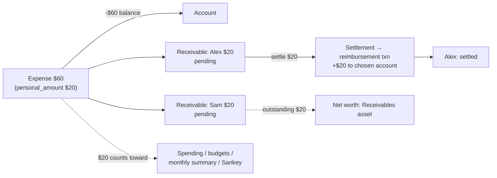

# Plan 021 — Shared Expenses / Reimbursements

Issue: [zihangg/kuberan#31](https://github.com/zihangg/kuberan/issues/31). Related: #23 (split transactions).

Revision 2: incorporates the principal-engineer review (concurrency, reversal and edit semantics,
test-schema reality, missed consumers) and drops the `contacts` entity in favour of a normalized
participant name.

## Context

When the user pays a group bill and friends repay later, Kuberan can only record the full bill
(overstating spending and budgets) or the user's share (wrong account balance, no record of who
owes what). This plan adds **shared expenses**: an expense whose full amount leaves the account,
whose **personal share** is what counts as spending, and whose other participants' shares become
**receivables** that are later settled by **reimbursements**. A reimbursement credits an account but
is not income.



## Findings that shape the design

1. **Spending is computed by SQL `SUM(amount)` over `type = 'expense'` in about eight places**, all
   in two files:
   - `transaction_service.go`: `GetMonthlySummary` (:613), `GetDailySpending` (:655),
     `GetDailySummary` (:691), `totalsByCategory` (:778, which feeds spending-by-category,
     `GetCashflow` and so the Sankey), `GetTopExpenses` (:874, which also orders by `amount` at
     :893).
   - `budget_service.go`: single-budget progress (:208) and batch progress (:256).
   Pointing all of them at one "effective amount" expression fixes every server-side report.

2. **Some consumers aggregate or enumerate transaction types outside those queries:**
   - `web/.../transactions/page.tsx:135` computes a per-day net in the browser from the full
     `amount`, counting income and expense only.
   - `web/.../accounts/[id]/page.tsx:68` has a `Record<TransactionType, …>` display map, plus
     `isNegative` logic.
   - The type-filter whitelists: `transaction_handler.go:304` and MCP `tools_transactions.go:118`.
   - The MCP transaction output (`tools_transactions.go:160`) and net-worth history
     (`tools_snapshots.go:70`).
   - The bot `/summary` "net" (`bot/handlers/summary.py:52`).

3. **Balance updates are neither locked nor relative.** `UpdateAccountBalance`
   (`account_service.go:335`) mutates an `Account` that was read *outside* the DB transaction, then
   writes the absolute value with `Update("balance", account.Balance)`. The services use no
   `FOR UPDATE` / `clause.Locking` anywhere. Concurrent writes can lose updates, and a "check
   outstanding, then settle" sequence races. `fixed_deposit_service.go:188` already uses the safe
   form, `UpdateColumn("balance", gorm.Expr("balance + ?", …))`. *(This race is pre-existing; this
   feature must not add more instances of it.)*

4. **The balance helpers know only income and expense.** `UpdateAccountBalance` silently does
   nothing for other types. `reverseType` (`transaction_service.go:328`) maps *every* non-income
   type to income, so reversing a reimbursement through it would credit the account twice.
   `DeleteTransaction` (:588) returns `ErrInvalidTransactionType` for unknown types.
   `UpdateTransaction` (:344) blocks only transfer and investment, in both directions.

5. **Sign inversion covers only `credit_card`** (`account_service.go:341`), not `debt`, despite
   CLAUDE.md saying both are inverted. This is pre-existing. It matters here because a repayment
   credited to a debt account would *increase* the debt.

6. **Income reports filter on `type = 'income'`**, so a new type is left out of income totals with
   no change. `validateTransactionType` (`validator.go:72`) whitelists the types a client may
   submit.

7. **Tests never run the SQL migrations.** `testutil/database.go:45` builds the schema with
   `AutoMigrate` from the models, in SQLite. SQL CHECKs and expression indexes don't exist in tests,
   and GORM's SQLite dialect ignores `FOR UPDATE`. **Every invariant must be enforced in service
   code.** SQL constraints are a Postgres-only backstop.

8. **`CreateTransaction` has about 89 call sites** (including mocks). Its signature should not
   change.

9. **Net worth is computed in two places that must agree**: the backend `computeSnapshot`
   (`portfolio_snapshot_service.go:66`) and the frontend composition card and accounts page.

10. **Audit logging lives in handlers** (`h.auditService.Log(...)`).

11. **#23 (split transactions) is not built yet.**

## Design decisions

| # | Topic | Decision |
|---|---|---|
| D1 | Data model | A nullable `transactions.personal_amount` column (denormalized, server-maintained), plus new tables `receivables` and `receivable_settlements`. Reports read a single-row expression: `COALESCE(personal_amount, amount)`. |
| D2 | People | **No contacts entity.** Each receivable stores `participant_name` (as typed, trimmed) and `participant_key` (lowercased, trimmed, internal whitespace collapsed), **computed in Go**. Grouping, autocomplete and rename all work on `participant_key`. A bulk rename (user-scoped, one DB transaction) handles both typos and merging duplicates (rename onto an existing key). If richer contacts are ever needed, a table can be backfilled from the distinct keys. |
| D3 | Repayment record | A settlement creates a `Transaction` of type **`reimbursement`** in the chosen account, linked via `receivable_settlements.transaction_id`. `reimbursement` is **not** in `validateTransactionType`. It can only be created by the settle service, and it can never be edited or deleted directly. |
| D4 | Net worth | **Outstanding receivables count as an asset**, in a new snapshot column `receivables_balance`: `net = cash + investments + FD + receivables − debt`. Settling is net-worth-neutral. Snapshots taken before this feature have `receivables_balance = 0`, which is intended (there were no receivables then). |
| D5 | Split input and rounding | The request lists **other participants only**. The user's share is always the remainder. Equal split: `share = floor(amount / (n_others + 1))` per other participant, and the user's share is `amount − Σ shares`, so leftover cents go to the user. Custom: each share must be `> 0`, and `Σ shares ≤ amount` (a user share of 0 is allowed: "I paid for them entirely"). |
| D6 | The `personal_amount` invariant | `personal_amount = amount − Σ receivables.amount`, over non-deleted receivables, or `NULL` when there are none. It is **never accepted from the client**. Exactly one helper, `recomputePersonalAmount(tx, txnID)`, writes it, and it runs after every receivable mutation. Tests assert the invariant after every operation. |
| D7 | Editing | The edit payload carries `receivables: [{id?, name, amount}]` and is **diffed, not replaced**: an entry with `id` updates in place (requires `amount ≥ paid_amount`; renaming is allowed); an entry without `id` is inserted; an omitted existing receivable is deleted **only if `paid_amount = 0`**, otherwise it is a 409. Changing `amount` re-validates `Σ shares ≤ amount`, and if the payload omits `receivables`, existing shares are kept as they are (no silent re-split). Changing `account_id` on a shared expense is allowed (settlements credit their own accounts). A type change away from `expense` while receivables exist is a 400. |
| D8 | Deleting | A shared expense with **no settlements**: soft-delete the expense and its receivables in one DB transaction. **With any settlement**: 409 `RECEIVABLE_HAS_SETTLEMENTS`; the user deletes settlements first. Deleting a settlement reverses its reimbursement and recomputes the receivable. |
| D9 | Settlement target accounts | Allowed only into `cash`, `credit_card` or `debt` accounts, not `investment` or `fixed_deposit`. A credit-card or debt repayment *reduces* the balance owed. This requires fixing Finding 5 so that `debt` is inverted too: a small, separately tested fix that lands in PR 1. |
| D10 | Concurrency | Every mutating operation (settle, delete settlement, edit or delete a shared expense) runs in one DB transaction that (1) locks the **expense row**, then (2) its **receivables**, then (3) the **account(s)**, always in that order, using `clause.Locking{Strength: "UPDATE"}`. It (4) re-reads state after locking, and (5) changes balances with relative `gorm.Expr("balance ± ?")` updates. New code uses a new relative helper, `ApplyBalanceDelta(tx, accountID, type, amount)`. Migrating existing callers onto it is a recommended follow-up, not part of this feature. |
| D11 | #23 interaction | `personal_amount` stays the single source of "my share". When #23 lands, its category splits divide **`personal_amount`** (not `amount`), and `totalsByCategory` reads split rows. Sharing decides *how much is mine*; splitting decides *which categories it goes to*. |
| D12 | Rules engine | Rule amount conditions keep matching the **full** `amount` (what the bank charged), which is documented. `candidateTransactions` already limits rules to income and expense, so reimbursements are never auto-categorized; a test asserts this. |

Receivable status is derived and stored for filtering: `pending` (`paid_amount = 0`),
`partially_paid`, or `settled` (`paid_amount = amount`). It is recomputed inside the same DB
transaction as every settlement change.

## Schema (migration `000030_create_shared_expenses`)

```sql
ALTER TABLE transactions ADD COLUMN personal_amount BIGINT NULL;   -- NULL = whole amount is mine
-- Postgres backstop: CHECK (personal_amount IS NULL OR personal_amount BETWEEN 0 AND amount)

CREATE TABLE receivables (
  id UUID PK, user_id UUID NOT NULL REFERENCES users,
  transaction_id UUID NOT NULL REFERENCES transactions,
  participant_name VARCHAR(100) NOT NULL,
  participant_key  VARCHAR(100) NOT NULL,          -- normalized in Go (D2)
  amount      BIGINT NOT NULL CHECK (amount > 0),
  paid_amount BIGINT NOT NULL DEFAULT 0 CHECK (paid_amount BETWEEN 0 AND amount),
  status VARCHAR(20) NOT NULL DEFAULT 'pending',
  created_at, updated_at, deleted_at
);
-- indexes: (user_id, status), (user_id, participant_key), (transaction_id)

CREATE TABLE receivable_settlements (
  id UUID PK, user_id UUID NOT NULL,
  receivable_id  UUID NOT NULL REFERENCES receivables,
  transaction_id UUID NOT NULL REFERENCES transactions,   -- the reimbursement txn
  amount BIGINT NOT NULL CHECK (amount > 0), date TIMESTAMPTZ NOT NULL,
  created_at, updated_at, deleted_at
);

ALTER TABLE portfolio_snapshots ADD COLUMN receivables_balance BIGINT NOT NULL DEFAULT 0;
```

The CHECKs are a Postgres-only backstop (Finding 7). The service layer enforces every rule above.
Every row carries `user_id`, and every query filters on it.

## Implementation, as PRs

### PR 1: behaviour-neutral groundwork

- An `effectiveAmountSQL = "COALESCE(personal_amount, amount)"` constant, used in all eight
  aggregates (Finding 1); `GetTopExpenses` orders by it and returns both values.
- The migration and models, with `PersonalAmount *int64` on `Transaction` (always NULL for now).
- `ApplyBalanceDelta` (a relative update; D10).
- The `debt` sign-inversion fix (Finding 5 / D9), with its own tests.
- **Gate:** golden tests showing every report endpoint returns identical results before and after,
  with `personal_amount` NULL.

### PR 2: shared-expense backend

1. **Models**: `TransactionTypeReimbursement`; `Receivable` and `ReceivableSettlement` in
   `models/receivable.go`; and `Transaction.Receivables`, preloaded on detail queries only (the
   `Attachments` pattern).
2. **Balance-helper fixes (Finding 4)**:
   - `reimbursement` in `UpdateAccountBalance` / `ApplyBalanceDelta`, with income semantics.
   - `reverseType` made explicit for every type, and it errors on unknown types instead of
     defaulting to income.
   - `DeleteTransaction` and `UpdateTransaction` reject a `reimbursement` in either direction
     (`ErrTransactionNotEditable` / `ErrInvalidTypeChange`).
3. **`ShareService`** (interface in `interfaces.go`). `CreateTransaction` is left unchanged
   (Finding 8).
   - `CreateSharedExpense(userID, input)`: one DB transaction that calls
     `createTransactionWithDB`, inserts the receivables, then runs `recomputePersonalAmount`.
   - `UpdateShares(userID, txnID, receivables)`: the D7 diff, under the D10 locks.
     `UpdateTransaction` calls the same internals when a shared expense's amount or type changes.
   - `Settle(userID, receivableID, accountID, amount, date)`: D10 locks; check
     `amount ≤ receivable.amount − paid_amount` and the D9 account type; create the reimbursement
     (description `"Repayment from <name>: <expense description>"`); insert the settlement;
     update `paid_amount` and `status`.
   - `DeleteSettlement`: the exact reverse.
   - `ListReceivables(status, participant_key, page)`, `SummaryByPerson()` (per key: display name,
     outstanding total, open bill count, oldest date, plus a grand total), `TotalOutstanding()`,
     `ListParticipantNames(prefix)` for autocomplete, and `RenameParticipant(fromKey, toName)`.
   - `DeleteTransaction` delegates to the D8 rules for a shared expense.
4. **Errors**: `RECEIVABLE_NOT_FOUND`, `RECEIVABLE_HAS_SETTLEMENTS`,
   `RECEIVABLE_HAS_PAYMENTS` (on removal in D7), `SETTLEMENT_EXCEEDS_OUTSTANDING`,
   `INVALID_SHARES`, `INVALID_SETTLEMENT_ACCOUNT`.
5. **Snapshot**: `receivables_balance = SUM(r.amount − r.paid_amount)`, joining non-deleted
   receivables to non-deleted expenses.
6. **Routes** (protected, audit-logged in the handler):
   ```
   POST   /api/v1/transactions/shared                 # {account_id, category_id?, amount, description, date, split: "equal"|"custom", receivables: [{name, amount?}]}
   PUT    /api/v1/transactions/:id/receivables        # D7 diff payload
   GET    /api/v1/receivables                         # ?status=&participant= paginated
   GET    /api/v1/receivables/summary                 # per-person totals + grand total
   GET    /api/v1/receivables/participants?q=         # autocomplete
   POST   /api/v1/receivables/participants/rename     # {from, to}
   POST   /api/v1/receivables/:id/settle              # {account_id, amount, date}
   DELETE /api/v1/receivables/settlements/:id
   ```
   Audit actions: `CREATE_SHARED_EXPENSE`, `UPDATE_RECEIVABLES`, `SETTLE_RECEIVABLE`,
   `DELETE_SETTLEMENT`, `RENAME_PARTICIPANT`. Add `reimbursement` to the **query-filter**
   whitelist (`transaction_handler.go:304`), not to the create validator. Regenerate Swagger.

### PR 3: web

1. Types: `reimbursement` in the `TransactionType` union, `personal_amount`, `Receivable`,
   `ReceivableSettlement` and the summary DTOs. Add the `reimbursement` entry to the
   `accounts/[id]/page.tsx` type map and `isNegative`, `lib/domain-visuals.ts`, and the
   type-filter options.
2. **Day net in the transactions list** (`transactions/page.tsx:135`): add reimbursement
   inflows so the day net matches the account movement. It stays cash flow, not spending, and is
   labelled accordingly.
3. Hooks: `use-receivables.ts` with a query-key factory. Each mutation invalidates receivables,
   transactions, accounts, the analytics, summary and budget keys, and snapshots.
4. **Create and edit dialogs**: a "Split with others" toggle on expenses only, with name inputs
   autocompleted from `/participants`, an Equal / Custom switch, and a read-only "Your share" row.
   The zod schema mirrors D5.
5. **Transaction detail and list**: a "Shared" badge, "Your share $20 of $60", per-person status
   pills, and "Record repayment" opening a settle dialog. Its account picker is limited to the D9
   types and defaults to the expense's account; the amount defaults to the outstanding balance.
6. **New page `(dashboard)/receivables`** (sidebar and command palette): a grand-total stat card, a
   per-person list ("Alex owes $12.50 across 2 bills") expanding to per-bill rows, a status filter,
   and a rename/merge action.
7. **Net worth**: the composition card and accounts-page totals add a "Receivables" asset slice
   from `/receivables/summary`.

### PR 4: MCP and bot (read-only)

- MCP: `list_receivables` and `get_receivables_summary` in `tools_receivables.go`. Add
  `reimbursement` to the filter whitelist (`tools_transactions.go:118`) and fix its error text.
  Show `personal_amount` in the transaction output (`tools_transactions.go:160`), and show
  receivables in `get_net_worth_history` (`tools_snapshots.go:70`).
- Bot: a read-only `/owed` command with the per-person summary. Relabel the `/summary` net as
  income minus spending (`summary.py:52`).

## Out of v1 (follow-ups)

- **The bot's split step** in the expense flow.
- **Write-off / forgive.** If added, it must keep D6: shrink the receivable's `amount` to
  `paid_amount` (so the remainder flows into `personal_amount`) and record the action. It also
  shifts spending into the expense's original month, which changes closed budgets; that needs a
  product decision.
- "Settle all for a person" (one reimbursement allocated oldest-first).
- Receivables in the oracle snapshot chart.
- Migrating existing balance writers to `ApplyBalanceDelta` and locking (Finding 3).

## Testing

All invariants are tested at the service level, because the SQLite test schema has no SQL
constraints (Finding 7).

- **The acceptance criteria verbatim**: a $60 / 3 split gives −$60 on the account and $20 in
  spending-by-category, cash flow, monthly and daily summaries, top expenses and budget progress.
  A $20 repayment gives +$20 on the account, $0 income, and the receivable `settled`.
- **The D6 invariant**, checked by a helper called after every operation in every test.
- **Rounding**: $10 shared with 2 others gives 333 / 333, with the user's share 334. A user share
  of 0 is accepted; a negative remainder or a zero share is rejected.
- **Partial payments**: status transitions; overpaying is rejected.
- **Settlement accounts**: into a credit card or debt account, the balance owed decreases;
  investment and FD accounts are rejected.
- **Edit diff (D7)**: update in place, insert, delete an unpaid receivable, a 409 on removing a
  paid one, an amount change below `Σ shares` rejected, an account change, type-change rejection,
  and a `reimbursement` edited or deleted directly is rejected.
- **Delete (D8)**: a cascade without settlements; a 409 with settlements; deleting a settlement
  reverses the balance and the status, with no double credit (a regression test for `reverseType`).
- **Snapshot**: includes outstanding receivables, ignores soft-deleted ones, and settlement is
  net-worth-neutral.
- **User isolation** across every endpoint, including rename.
- **Atomicity**: a forced failure mid-settle leaves no partial rows and an unchanged balance.
- **Concurrency**: SQLite can't exercise `FOR UPDATE`, so add one Postgres-tagged test
  (`//go:build postgres`, run in CI against the compose database). It runs two concurrent settles
  that together exceed the outstanding amount, and exactly one must succeed.
- **Handler tests**: validation and an audit `Log` call per action.
- **Integration**: `tests/integration/shared_expense_flow_test.go` for the full lifecycle.
- Run `./scripts/check-go.sh apps/api`, plus web lint and typecheck.

## Open questions

1. **Net worth (D4).** Count outstanding receivables as an asset (the proposal), or exclude them?
2. **Concurrency test.** Is a Postgres-tagged test job in CI acceptable, or is service-level
   locking without an automated race test enough for now?
3. **Income sharing.** Should shared *income* (for example, collecting group money up front) be
   supported? It is proposed as out of scope.
