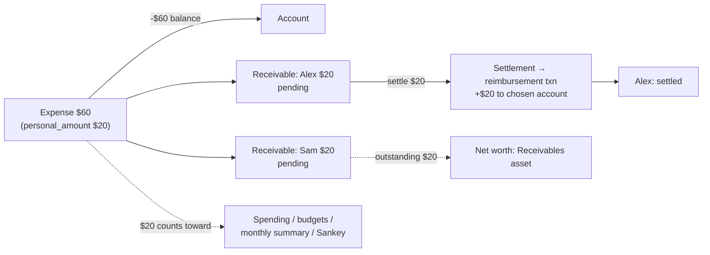

# Plan 021 — Receivables: Shared Expenses, Claims, Loans & Deposits

Issue: [zihangg/kuberan#31](https://github.com/zihangg/kuberan/issues/31). Related: #23 (split transactions).

Revision 3:
- Revision 2 incorporated the principal-engineer review (concurrency, reversal and edit semantics,
  test-schema reality, missed consumers) and dropped the `contacts` entity.
- Revision 3 generalizes the feature from "shared expenses" to **receivables**: money that leaves an
  account now, is expected back, and is not spending. It renames participant to **counterparty**,
  adds a receivable **`kind`**, makes a $0 personal share first-class, and brings **write-off** into
  v1.

## Context

When the user pays a group bill and friends repay later, Kuberan can only record the full bill
(overstating spending and budgets) or the user's share (wrong account balance, no record of who
owes what). The same problem appears whenever money leaves an account but is expected back:

| Kind | Example | Personal share | How it closes |
|---|---|---|---|
| `split` | A $60 lunch shared with two friends | Your part ($20) | Repayments |
| `on_behalf` | Buying a friend's concert ticket | $0 | A repayment |
| `claim` | A work flight reimbursed by your employer, or a medical bill partly covered by insurance | $0 | A repayment, and a write-off for any uncovered part |
| `loan` | Lending Alex $500 | $0 | Repayments, or a write-off if it's forgiven |
| `deposit` | A rental or utility deposit | $0 | A return, and a write-off for deductions |
| `refund` | A returned item awaiting a merchant refund | $0 | The refund |

This plan adds **receivables**. They are created from an expense whose full amount leaves the
account and whose **personal share** (possibly $0) is what counts as spending. Each counterparty's
share is a receivable, closed by **reimbursements** (which credit an account and are not income)
and/or a **write-off** (the unrecovered remainder becomes the user's spending). The issue's
shared-expense flow is the `split` kind.



## Findings that shape the design

1. **Spending is computed by SQL `SUM(amount)` over `type = 'expense'` in about eight places**, all
   in two files:
   - `transaction_service.go`: `GetMonthlySummary` (:613), `GetDailySpending` (:655),
     `GetDailySummary` (:691), `totalsByCategory` (:778, which feeds spending-by-category,
     `GetCashflow` and so the Sankey), `GetTopExpenses` (:874, which also orders by `amount` at
     :893).
   - `budget_service.go`: single-budget progress (:208) and batch progress (:256).
   Pointing all of them at one "effective amount" expression fixes every server-side report.

2. **Some consumers aggregate or enumerate transaction types outside those queries:**
   - `web/.../transactions/page.tsx:135` computes a per-day net in the browser from the full
     `amount`, counting income and expense only.
   - `web/.../accounts/[id]/page.tsx:68` has a `Record<TransactionType, …>` display map, plus
     `isNegative` logic.
   - The type-filter whitelists: `transaction_handler.go:304` and MCP `tools_transactions.go:118`.
   - The MCP transaction output (`tools_transactions.go:160`) and net-worth history
     (`tools_snapshots.go:70`).
   - The bot `/summary` "net" (`bot/handlers/summary.py:52`).

3. **Balance updates are neither locked nor relative.** `UpdateAccountBalance`
   (`account_service.go:335`) mutates an `Account` that was read *outside* the DB transaction, then
   writes the absolute value with `Update("balance", account.Balance)`. The services use no
   `FOR UPDATE` / `clause.Locking` anywhere. Concurrent writes can lose updates, and a "check
   outstanding, then settle" sequence races. `fixed_deposit_service.go:188` already uses the safe
   form, `UpdateColumn("balance", gorm.Expr("balance + ?", …))`. *(This race is pre-existing; this
   feature must not add more instances of it.)*

4. **The balance helpers know only income and expense.** `UpdateAccountBalance` silently does
   nothing for other types. `reverseType` (`transaction_service.go:328`) maps *every* non-income
   type to income, so reversing a reimbursement through it would credit the account twice.
   `DeleteTransaction` (:588) returns `ErrInvalidTransactionType` for unknown types.
   `UpdateTransaction` (:344) blocks only transfer and investment, in both directions.

5. **Sign inversion covers only `credit_card`** (`account_service.go:341`), not `debt`, despite
   CLAUDE.md saying both are inverted. This is pre-existing. It matters here because a repayment
   credited to a debt account would *increase* the debt.

6. **Income reports filter on `type = 'income'`**, so a new type is left out of income totals with
   no change. `validateTransactionType` (`validator.go:72`) whitelists the types a client may
   submit.

7. **Tests never run the SQL migrations.** `testutil/database.go:45` builds the schema with
   `AutoMigrate` from the models, in SQLite. SQL CHECKs and expression indexes don't exist in tests,
   and GORM's SQLite dialect ignores `FOR UPDATE`. **Every invariant must be enforced in service
   code.** SQL constraints are a Postgres-only backstop.

8. **`CreateTransaction` has about 89 call sites** (including mocks). Its signature should not
   change.

9. **Net worth is computed in two places that must agree**: the backend `computeSnapshot`
   (`portfolio_snapshot_service.go:66`) and the frontend composition card and accounts page.

10. **Audit logging lives in handlers** (`h.auditService.Log(...)`).

11. **#23 (split transactions) is not built yet.**

## Design decisions

| # | Topic | Decision |
|---|---|---|
| D1 | Data model | ("Shared expense" below means any expense that has receivables, of any kind.) A nullable `transactions.personal_amount` column (denormalized, server-maintained), plus new tables `receivables` and `receivable_settlements`. Reports read a single-row expression: `COALESCE(personal_amount, amount)`. |
| D2 | Counterparties | **No contacts entity.** A counterparty is anyone who owes the user: a friend, an employer, an insurer, a landlord or a merchant. Each receivable stores `counterparty_name` (as typed, trimmed) and `counterparty_key` (lowercased, trimmed, internal whitespace collapsed), **computed in Go**. Grouping, autocomplete and rename all work on `counterparty_key`. A bulk rename (user-scoped, one DB transaction) handles both typos and merging duplicates (rename onto an existing key). If richer contacts are ever needed, a table can be backfilled from the distinct keys. |
| D2a | Kind | `receivables.kind` is one of `split`, `on_behalf`, `claim`, `loan`, `deposit` or `refund` (validated in Go). It is set per expense at creation, can be changed later, and is used for filtering and labels only. **No behaviour depends on it**, so the same code paths serve every kind. |
| D3 | Repayment record | A settlement creates a `Transaction` of type **`reimbursement`** in the chosen account, linked via `receivable_settlements.transaction_id`. `reimbursement` is **not** in `validateTransactionType`. It can only be created by the settle service, and it can never be edited or deleted directly. |
| D4 | Net worth | **Outstanding receivables count as an asset**, in a new snapshot column `receivables_balance`: `net = cash + investments + FD + receivables − debt`. Settling is net-worth-neutral. Snapshots taken before this feature have `receivables_balance = 0`, which is intended (there were no receivables then). |
| D5 | Split input and rounding | The request lists **counterparties only**. The user's share is always the remainder. Equal split: `share = floor(amount / (n_counterparties + 1))` per counterparty, and the user's share is `amount − Σ shares`, so leftover cents go to the user. Custom: each share must be `> 0`, and `Σ shares ≤ amount`. **A user share of 0 is a first-class case**: "full amount" mode with a single counterparty owing everything, used by `on_behalf`, `claim`, `loan`, `deposit` and `refund`. For these, `category_id` is optional. With an effective amount of 0, the expense contributes nothing to spending, and `GetTopExpenses` excludes rows whose effective amount is 0. |
| D6 | The `personal_amount` invariant | `personal_amount = amount − Σ (receivables.amount − receivables.written_off_amount)`, over non-deleted receivables, or `NULL` when there are none. A write-off therefore moves money from "owed to me" into "my spending" without touching the receivable's original `amount`. It is **never accepted from the client**. Exactly one helper, `recomputePersonalAmount(tx, txnID)`, writes it, and it runs after every receivable mutation. Tests assert the invariant after every operation. |
| D6a | Write-off (v1) | `POST /receivables/:id/write-off {amount?}` (default: the whole outstanding balance) adds to `written_off_amount`. It requires `paid_amount + written_off_amount ≤ amount`, takes the D10 locks, and runs `recomputePersonalAmount`. Settle also accepts `write_off_remainder: true`, so "deposit returned $850 of $1,000" is one action. A write-off is reversible (`DELETE /receivables/:id/write-off` resets it to 0). **Timing:** the written-off amount counts as spending **in the expense's original date** (it is part of that transaction's effective amount). That can change a closed month's budget; this is accepted and shown in the UI ("adds $150 to March spending"). The alternative, a dated write-off row, would require every aggregate to union a second table, so it is rejected for v1. |
| D7 | Editing | The edit payload carries `receivables: [{id?, name, amount}]` and is **diffed, not replaced**: an entry with `id` updates in place (requires `amount ≥ paid_amount + written_off_amount`; renaming and changing `kind` are allowed); an entry without `id` is inserted; an omitted existing receivable is deleted **only if `paid_amount = 0`**, otherwise it is a 409. Changing `amount` re-validates `Σ shares ≤ amount`, and if the payload omits `receivables`, existing shares are kept as they are (no silent re-split). Changing `account_id` on a shared expense is allowed (settlements credit their own accounts). A type change away from `expense` while receivables exist is a 400. |
| D8 | Deleting | A shared expense with **no settlements**: soft-delete the expense and its receivables in one DB transaction. **With any settlement**: 409 `RECEIVABLE_HAS_SETTLEMENTS`; the user deletes settlements first. Deleting a settlement reverses its reimbursement and recomputes the receivable. |
| D9 | Settlement target accounts | Allowed only into `cash`, `credit_card` or `debt` accounts, not `investment` or `fixed_deposit`. A credit-card or debt repayment *reduces* the balance owed. This requires fixing Finding 5 so that `debt` is inverted too: a small, separately tested fix that lands in PR 1. |
| D10 | Concurrency | Every mutating operation (settle, delete settlement, edit or delete a shared expense) runs in one DB transaction that (1) locks the **expense row**, then (2) its **receivables**, then (3) the **account(s)**, always in that order, using `clause.Locking{Strength: "UPDATE"}`. It (4) re-reads state after locking, and (5) changes balances with relative `gorm.Expr("balance ± ?")` updates. New code uses a new relative helper, `ApplyBalanceDelta(tx, accountID, type, amount)`. Migrating existing callers onto it is a recommended follow-up, not part of this feature. |
| D11 | #23 interaction | `personal_amount` stays the single source of "my share". When #23 lands, its category splits divide **`personal_amount`** (not `amount`), and `totalsByCategory` reads split rows. Sharing decides *how much is mine*; splitting decides *which categories it goes to*. |
| D12 | Rules engine | Rule amount conditions keep matching the **full** `amount` (what the bank charged), which is documented. `candidateTransactions` already limits rules to income and expense, so reimbursements are never auto-categorized; a test asserts this. |

Receivable status is derived and stored for filtering, with `outstanding = amount − paid_amount −
written_off_amount`:
- `pending`: nothing paid or written off yet.
- `partially_paid`: `outstanding > 0` and something has been paid.
- `settled`: `outstanding = 0` and `written_off_amount = 0`.
- `written_off`: `outstanding = 0` and `written_off_amount > 0`.

It is recomputed inside the same DB transaction as every settlement or write-off change.

## Schema (migration `000030_create_shared_expenses`)

```sql
ALTER TABLE transactions ADD COLUMN personal_amount BIGINT NULL;   -- NULL = whole amount is mine
-- Postgres backstop: CHECK (personal_amount IS NULL OR personal_amount BETWEEN 0 AND amount)

CREATE TABLE receivables (
  id UUID PK, user_id UUID NOT NULL REFERENCES users,
  transaction_id UUID NOT NULL REFERENCES transactions,
  counterparty_name VARCHAR(100) NOT NULL,
  counterparty_key  VARCHAR(100) NOT NULL,         -- normalized in Go (D2)
  kind VARCHAR(20) NOT NULL DEFAULT 'split',       -- D2a
  amount             BIGINT NOT NULL CHECK (amount > 0),
  paid_amount        BIGINT NOT NULL DEFAULT 0 CHECK (paid_amount >= 0),
  written_off_amount BIGINT NOT NULL DEFAULT 0 CHECK (written_off_amount >= 0),
  -- CHECK (paid_amount + written_off_amount <= amount)
  status VARCHAR(20) NOT NULL DEFAULT 'pending',
  created_at, updated_at, deleted_at
);
-- indexes: (user_id, status), (user_id, counterparty_key), (user_id, kind), (transaction_id)

CREATE TABLE receivable_settlements (
  id UUID PK, user_id UUID NOT NULL,
  receivable_id  UUID NOT NULL REFERENCES receivables,
  transaction_id UUID NOT NULL REFERENCES transactions,   -- the reimbursement txn
  amount BIGINT NOT NULL CHECK (amount > 0), date TIMESTAMPTZ NOT NULL,
  created_at, updated_at, deleted_at
);

ALTER TABLE portfolio_snapshots ADD COLUMN receivables_balance BIGINT NOT NULL DEFAULT 0;
```

The CHECKs are a Postgres-only backstop (Finding 7). The service layer enforces every rule above.
Every row carries `user_id`, and every query filters on it.

## Implementation, as PRs

### PR 1: behaviour-neutral groundwork

- An `effectiveAmountSQL = "COALESCE(personal_amount, amount)"` constant, used in all eight
  aggregates (Finding 1); `GetTopExpenses` orders by it and returns both values.
- The migration and models, with `PersonalAmount *int64` on `Transaction` (always NULL for now).
- `ApplyBalanceDelta` (a relative update; D10).
- The `debt` sign-inversion fix (Finding 5 / D9), with its own tests.
- **Gate:** golden tests showing every report endpoint returns identical results before and after,
  with `personal_amount` NULL.

### PR 2: shared-expense backend

1. **Models**: `TransactionTypeReimbursement`; `Receivable` and `ReceivableSettlement` in
   `models/receivable.go`; and `Transaction.Receivables`, preloaded on detail queries only (the
   `Attachments` pattern).
2. **Balance-helper fixes (Finding 4)**:
   - `reimbursement` in `UpdateAccountBalance` / `ApplyBalanceDelta`, with income semantics.
   - `reverseType` made explicit for every type, and it errors on unknown types instead of
     defaulting to income.
   - `DeleteTransaction` and `UpdateTransaction` reject a `reimbursement` in either direction
     (`ErrTransactionNotEditable` / `ErrInvalidTypeChange`).
3. **`ReceivableService`** (interface in `interfaces.go`). `CreateTransaction` is left unchanged
   (Finding 8).
   - `CreateSharedExpense(userID, input)`: one DB transaction that calls
     `createTransactionWithDB`, inserts the receivables, then runs `recomputePersonalAmount`.
     The input carries `kind`, `mode` (`equal` / `custom` / `full`), and counterparties. `full`
     means exactly one counterparty owes the entire amount and the personal share is $0 (D5).
   - `UpdateShares(userID, txnID, receivables)`: the D7 diff, under the D10 locks.
     `UpdateTransaction` calls the same internals when a shared expense's amount or type changes.
   - `Settle(userID, receivableID, accountID, amount, date)`: D10 locks; check
     `amount ≤ outstanding` and the D9 account type; create the reimbursement
     (description `"Repayment from <name>: <expense description>"`); insert the settlement;
     update `paid_amount` and `status`.
   - `DeleteSettlement`: the exact reverse.
   - `WriteOff(userID, receivableID, amount?)` and `UndoWriteOff`: D6a, under the D10 locks.
     `Settle` takes an optional `writeOffRemainder` and does both in one DB transaction.
   - `ListReceivables(status, kind, counterparty_key, page)`, `SummaryByCounterparty()` (per key:
     display name, outstanding total, open item count, oldest date, plus a grand total and
     per-kind totals), `TotalOutstanding()`, `ListCounterpartyNames(prefix)` for autocomplete,
     and `RenameCounterparty(fromKey, toName)`.
   - `DeleteTransaction` delegates to the D8 rules for a shared expense. Write-offs don't block a
     delete; only settlements do.
4. **Errors**: `RECEIVABLE_NOT_FOUND`, `RECEIVABLE_HAS_SETTLEMENTS`,
   `RECEIVABLE_HAS_PAYMENTS` (on removal in D7), `SETTLEMENT_EXCEEDS_OUTSTANDING`,
   `INVALID_SHARES`, `INVALID_SETTLEMENT_ACCOUNT`, `INVALID_RECEIVABLE_KIND`,
   `WRITE_OFF_EXCEEDS_OUTSTANDING`.
5. **Snapshot**: `receivables_balance = SUM(r.amount − r.paid_amount − r.written_off_amount)`,
   joining non-deleted receivables to non-deleted expenses.
6. **Routes** (protected, audit-logged in the handler):
   ```
   POST   /api/v1/transactions/shared                 # {account_id, category_id?, amount, description, date, kind, mode: "equal"|"custom"|"full", counterparties: [{name, amount?}]}
   PUT    /api/v1/transactions/:id/receivables        # D7 diff payload
   GET    /api/v1/receivables                         # ?status=&kind=&counterparty= paginated
   GET    /api/v1/receivables/summary                 # per-counterparty + per-kind totals + grand total
   GET    /api/v1/receivables/counterparties?q=       # autocomplete
   POST   /api/v1/receivables/counterparties/rename   # {from, to}
   POST   /api/v1/receivables/:id/settle              # {account_id, amount, date, write_off_remainder?}
   DELETE /api/v1/receivables/settlements/:id
   POST   /api/v1/receivables/:id/write-off           # {amount?}  (D6a)
   DELETE /api/v1/receivables/:id/write-off           # undo
   ```
   Audit actions: `CREATE_SHARED_EXPENSE`, `UPDATE_RECEIVABLES`, `SETTLE_RECEIVABLE`,
   `DELETE_SETTLEMENT`, `WRITE_OFF_RECEIVABLE`, `UNDO_WRITE_OFF`, `RENAME_COUNTERPARTY`. Add `reimbursement` to the **query-filter**
   whitelist (`transaction_handler.go:304`), not to the create validator. Regenerate Swagger.

### PR 3: web

1. Types: `reimbursement` in the `TransactionType` union, `personal_amount`, `Receivable`,
   `ReceivableSettlement` and the summary DTOs. Add the `reimbursement` entry to the
   `accounts/[id]/page.tsx` type map and `isNegative`, `lib/domain-visuals.ts`, and the
   type-filter options.
2. **Day net in the transactions list** (`transactions/page.tsx:135`): add reimbursement
   inflows so the day net matches the account movement. It stays cash flow, not spending, and is
   labelled accordingly.
3. Hooks: `use-receivables.ts` with a query-key factory. Each mutation invalidates receivables,
   transactions, accounts, the analytics, summary and budget keys, and snapshots.
4. **Create and edit dialogs**: on expenses only, a "Money owed back" section with these modes,
   each mapping to a `kind` and `mode` and posting to the same endpoint:
   - **Split with others** (`split`; Equal or Custom).
   - **Paid for someone** (`on_behalf`, `full`).
   - **Work or insurance claim** (`claim`, `full`; a partial claim uses Custom).
   - **Deposit** (`deposit`, `full`).
   - **Awaiting refund** (`refund`, `full`).
   Counterparty name inputs autocomplete from `/counterparties`, and a read-only "Your share" row
   shows what counts as spending. Category becomes optional when your share is $0. The zod schema
   mirrors D5.
5. **"Lend money" entry point** in the command palette and the account page's actions. It is the
   same endpoint with `kind: loan`, `mode: full` and no category, but worded as a loan ("Lend $500
   to Alex from …") so the user never thinks of it as an expense.
6. **Transaction detail and list**: a kind badge ("Split", "Claim", "Loan", …), "Your share $20 of
   $60", per-counterparty status pills, and two actions:
   - **Record repayment** opens a settle dialog. Its account picker is limited to the D9 types and
     defaults to the expense's account; the amount defaults to the outstanding balance. A "Write
     off the rest" checkbox shows the spending impact ("adds $150 to March spending").
   - **Write off** forgives the outstanding balance, with the same impact text.
7. **New page `(dashboard)/receivables`, titled "Owed to me"** (sidebar and command palette): a
   grand-total stat card with per-kind totals, a per-counterparty list ("Alex owes $12.50 across 2
   items") expanding to per-item rows, status and kind filters, and a rename/merge action.
8. **Net worth**: the composition card and accounts-page totals add a "Receivables" asset slice
   from `/receivables/summary`.

### PR 4: MCP and bot (read-only)

- MCP: `list_receivables` and `get_receivables_summary` in `tools_receivables.go`. Add
  `reimbursement` to the filter whitelist (`tools_transactions.go:118`) and fix its error text.
  Show `personal_amount` in the transaction output (`tools_transactions.go:160`), and show
  receivables in `get_net_worth_history` (`tools_snapshots.go:70`).
- Bot: a read-only `/owed` command with the per-counterparty summary. Relabel the `/summary` net as
  income minus spending (`summary.py:52`).

## Out of v1 (follow-ups)

- **The bot's split step** in the expense flow.
- **Payables (I owe someone).** A friend pays for you and you repay later: spending happens with no
  account movement until the repayment. It mirrors receivables (a `direction` column, plus a
  "spending with no cash movement" transaction). The `receivables` naming leaves room for a sibling
  `payables` table or a `direction` column later; nothing in v1 assumes it won't exist.
- **Recurring splits.** Templates for monthly rent or utilities with housemates.
- **Dated write-offs**, so forgiven spending lands in the write-off month rather than the expense's
  month (see D6a for why v1 doesn't do this).
- "Settle all for a counterparty" (one reimbursement allocated oldest-first).
- Receivables in the oracle snapshot chart.
- Migrating existing balance writers to `ApplyBalanceDelta` and locking (Finding 3).

## Testing

All invariants are tested at the service level, because the SQLite test schema has no SQL
constraints (Finding 7).

- **The acceptance criteria verbatim**: a $60 / 3 split gives −$60 on the account and $20 in
  spending-by-category, cash flow, monthly and daily summaries, top expenses and budget progress.
  A $20 repayment gives +$20 on the account, $0 income, and the receivable `settled`.
- **The D6 invariant**, checked by a helper called after every operation in every test.
- **Rounding**: $10 shared with 2 others gives 333 / 333, with the user's share 334. A user share
  of 0 is accepted; a negative remainder or a zero share is rejected.
- **Partial payments**: status transitions; overpaying is rejected.
- **Full mode / $0 share** (`on_behalf`, `claim`, `loan`, `deposit`, `refund`): the account
  drops by the full amount, spending and budgets are unchanged, the expense is absent from top
  expenses, there is no category, and net worth is unchanged (the cash moves into receivables).
- **Write-off (D6a)**: deposit $1,000, returned $850 with `write_off_remainder` → status
  `written_off`, $150 added to spending in the expense's month, receivables total 0, and the
  invariant holds. A write-off over the outstanding balance is rejected. Undoing restores the
  previous state. A write-off doesn't block deleting the expense.
- **Kind**: invalid kinds are rejected; filtering by kind; changing kind via the D7 edit.
- **Settlement accounts**: into a credit card or debt account, the balance owed decreases;
  investment and FD accounts are rejected.
- **Edit diff (D7)**: update in place, insert, delete an unpaid receivable, a 409 on removing a
  paid one, an amount change below `Σ shares` rejected, an account change, type-change rejection,
  and a `reimbursement` edited or deleted directly is rejected.
- **Delete (D8)**: a cascade without settlements; a 409 with settlements; deleting a settlement
  reverses the balance and the status, with no double credit (a regression test for `reverseType`).
- **Snapshot**: includes outstanding receivables, ignores soft-deleted ones, and settlement is
  net-worth-neutral.
- **User isolation** across every endpoint, including rename.
- **Atomicity**: a forced failure mid-settle leaves no partial rows and an unchanged balance.
- **Concurrency**: SQLite can't exercise `FOR UPDATE`, so add one Postgres-tagged test
  (`//go:build postgres`, run in CI against the compose database). It runs two concurrent settles
  that together exceed the outstanding amount, and exactly one must succeed.
- **Handler tests**: validation and an audit `Log` call per action.
- **Integration**: `tests/integration/shared_expense_flow_test.go` for the full lifecycle.
- Run `./scripts/check-go.sh apps/api`, plus web lint and typecheck.

## Open questions

1. **Net worth (D4).** Count outstanding receivables as an asset (the proposal), or exclude them?
2. **Concurrency test.** Is a Postgres-tagged test job in CI acceptable, or is service-level
   locking without an automated race test enough for now?
3. **Income sharing.** Should shared *income* (for example, collecting group money up front) be
   supported? It is proposed as out of scope.
4. **Write-off timing (D6a).** Is it acceptable for forgiven amounts to count as spending in the
   expense's month rather than the write-off month?
5. **Kinds.** Is the six-kind list (`split`, `on_behalf`, `claim`, `loan`, `deposit`, `refund`)
   right? Since behaviour doesn't depend on kind, adding one later is cheap.
