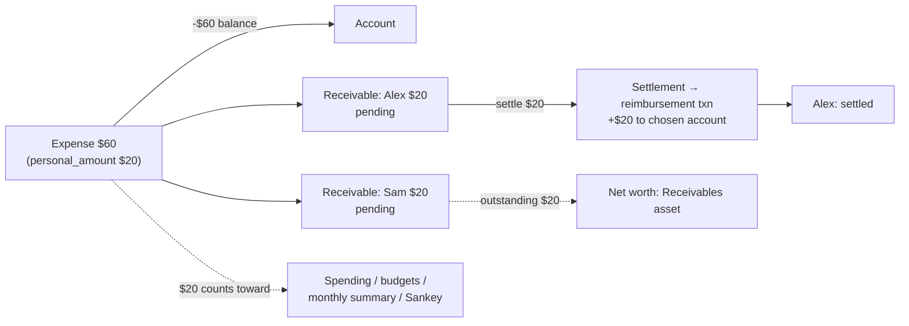

# Plan 021 — Shared Expenses / Reimbursements

Issue: [zihangg/kuberan#31](https://github.com/zihangg/kuberan/issues/31). Related: #23 (split transactions).

## Context

When the user pays a group bill and friends repay later, Kuberan can only record the full bill
(overstating spending and budgets) or the user's share (wrong account balance, no record of who
owes what). This plan adds **shared expenses**: an expense whose full amount leaves the account,
whose **personal share** is what counts as spending, and whose other participants' shares become
**receivables** that are later settled by **reimbursements**. A reimbursement credits an account but
is not income.



## Findings that shape the design

1. **Spending is computed by SQL `SUM(amount)` over `type = 'expense'` in about eight places**, all
   in two files:
   - `transaction_service.go`: `GetMonthlySummary` (:613), `GetDailySpending` (:655),
     `GetDailySummary` (:691), `totalsByCategory` (:778, which feeds `GetSpendingByCategory` and
     `GetCashflow`, so also the Sankey), `GetTopExpenses` (:874).
   - `budget_service.go`: single-budget progress (:208) and batch progress (:256).

   MCP tools (`internal/mcp/tools_transactions.go`), the Telegram `/summary` command and the web
   dashboard charts all read these endpoints. The web does not re-aggregate transactions on its
   own. **Swapping `SUM(amount)` for one shared "effective amount" expression in those queries
   fixes every report at once.**

2. **`UpdateAccountBalance` (`account_service.go:335`) only knows `income` and `expense`.** Any
   other type silently changes nothing. A credit to an account that isn't income needs a new type
   added to that switch, with the same credit-card sign inversion as income.

3. **Income reports already filter on `type = 'income'`**, and `GetMonthlySummary` also skips
   `description != 'Initial balance'`. A new transaction type is therefore left out of income
   totals with no further change, which is exactly what reimbursements need.

4. **`transactions.type` is `VARCHAR(20)` with no CHECK constraint**, so a new type needs no
   migration on that column. `DeleteTransaction` (:572) returns `ErrInvalidTransactionType` for
   types it doesn't know, and `UpdateTransaction` (:337) rejects edits to transfer and investment.
   Both switches need explicit handling for the new type.

5. **Net worth is computed in two places that must agree** (the same lesson as plan 020): the
   backend `computeSnapshot` (`portfolio_snapshot_service.go:66`) and the frontend
   composition card and accounts page, which sum `accounts.balance` by type.

6. **Audit logging happens in handlers** (`h.auditService.Log(...)` in `transaction_handler.go`),
   not in services. New receivable and settlement handlers follow that pattern.

7. **#23 (split transactions) is not built yet.** This plan must not block it (see D7).

## Design decisions (proposed; confirm in review)

| # | Topic | Proposal | Why |
|---|---|---|---|
| D1 | Data model | **Hybrid.** Add a nullable `personal_amount BIGINT` column on `transactions`, plus new tables `contacts`, `receivables` and `receivable_settlements`. | Reports need the user's share in a single-row expression (`COALESCE(personal_amount, amount)`); a join plus subtraction in eight queries would be slow and easy to get wrong. Receivables need their own rows for status, per-person views and partial payments. |
| D2 | People | **Add a lightweight `contacts` entity** (`id, user_id, name`, unique per user on `lower(name)`). The API accepts either `contact_id` or `name` and creates the contact if it doesn't exist. | "Alex owes $12.50 across 2 bills" requires a stable identity. Free-text names drift ("Alex" vs "alex "). Keeping it to a name only stays minimal. |
| D3 | Repayment record | **A settlement creates a `Transaction` of new type `reimbursement`** in the chosen account, linked from `receivable_settlements.transaction_id`. | The account history shows the inflow, so the balance stays explainable. Income aggregates leave it out automatically (Finding 3). It also reuses the balance and lock path. |
| D4 | Net worth | **Count outstanding receivables as an asset.** Add a new snapshot column `receivables_balance`: `net = cash + investments + FD + receivables − debt`. | Matches the spending treatment: only $20 is "gone", so net worth should only drop $20. Settlement is then net-worth-neutral (cash +$20, receivable −$20), which is what acceptance criterion 2 implies. The excluded alternative would make net worth dip by $40 and jump back on repayment. |
| D5 | Split rounding | Equal split: `floor(total / n)` each, with **leftover cents added to the user's own share**. Custom amounts must sum exactly to `amount`, or the request is a 400. | Deterministic, friends see round amounts, and the user never under-records their own spending. |
| D6 | Edit and delete | **Delete:** soft-delete the expense and its receivables in one DB transaction. If any receivable has settlements, **reject with `RECEIVABLE_HAS_SETTLEMENTS` (409)**: the user deletes the settlements first, each of which reverses its reimbursement. **Edit:** the participants list may be replaced in full. Each receivable keeps `amount >= paid_amount`. A type change away from `expense` on a shared expense is rejected. | Silently reversing money that actually arrived is surprising. An explicit error keeps every balance change traceable. |
| D7 | #23 interaction | `personal_amount` stays the single source of "my share". When #23 lands, its splits divide **`personal_amount`** across categories (they sum to it, not to `amount`), and `totalsByCategory` reads the split rows. | Keeps the two features orthogonal: sharing decides *how much is mine*, splitting decides *which categories it goes to*. |
| D8 | Forgiveness (optional, phase 4) | `POST /receivables/:id/write-off`: status `written_off`, and the unpaid remainder is added to `personal_amount`. | Handles "never mind, it's on me" correctly: the forgiven amount becomes the user's spending. |

Receivable status is derived, not set by the client: `pending` when `paid_amount = 0`,
`partially_paid` when `0 < paid_amount < amount`, `settled` when `paid_amount = amount`, plus
`written_off` (D8). It is stored for cheap filtering and recomputed in the same DB transaction on
every settlement change.

## Schema (migration `000030_create_shared_expenses`)

```sql
ALTER TABLE transactions ADD COLUMN personal_amount BIGINT NULL;  -- NULL = whole amount is mine
-- CHECK (personal_amount IS NULL OR (personal_amount >= 0 AND personal_amount <= amount))

CREATE TABLE contacts (
  id UUID PK, user_id UUID NOT NULL REFERENCES users, name VARCHAR(100) NOT NULL,
  created_at, updated_at, deleted_at
);
CREATE UNIQUE INDEX ux_contacts_user_name ON contacts (user_id, lower(name)) WHERE deleted_at IS NULL;

CREATE TABLE receivables (
  id UUID PK, user_id UUID NOT NULL, transaction_id UUID NOT NULL REFERENCES transactions,
  contact_id UUID NOT NULL REFERENCES contacts,
  amount BIGINT NOT NULL CHECK (amount > 0),
  paid_amount BIGINT NOT NULL DEFAULT 0 CHECK (paid_amount >= 0 AND paid_amount <= amount),
  status VARCHAR(20) NOT NULL DEFAULT 'pending',
  created_at, updated_at, deleted_at
);
-- indexes: (user_id, status), (transaction_id), (contact_id)

CREATE TABLE receivable_settlements (
  id UUID PK, user_id UUID NOT NULL, receivable_id UUID NOT NULL REFERENCES receivables,
  transaction_id UUID NOT NULL REFERENCES transactions,  -- the reimbursement txn
  amount BIGINT NOT NULL CHECK (amount > 0), date TIMESTAMPTZ NOT NULL,
  created_at, updated_at, deleted_at
);

ALTER TABLE portfolio_snapshots ADD COLUMN receivables_balance BIGINT NOT NULL DEFAULT 0;
```

Every row carries `user_id`, and every query filters on it (CLAUDE.md design decision 3). The down
migration drops the tables and columns in reverse order.

## Implementation phases

### Phase 1: Backend core (API)

1. **Models** (`internal/models/`): `TransactionTypeReimbursement = "reimbursement"`; a
   `PersonalAmount *int64` field on `Transaction`, plus `Receivables []Receivable`, preloaded on
   detail queries only (same pattern as `Attachments`); new `contact.go` and `receivable.go`
   (`Receivable`, `ReceivableSettlement`, a `ReceivableStatus` enum).
2. **Effective-amount helper**: one constant/function in `transaction_service.go`, e.g.
   `const effectiveAmountSQL = "COALESCE(personal_amount, amount)"`, used in all eight
   aggregate queries from Finding 1. `GetTopExpenses` ranks by the effective amount and returns
   both values, so the UI can show "$20 of $60".
3. **`UpdateAccountBalance`**: add `reimbursement` to the switch with the income branch's
   semantics (credit-card sign inversion included).
4. **`ContactService`**: `List`, `Create`, `Rename`, `Delete` (soft; blocked while open receivables
   exist), and `ResolveOrCreate(userID, idOrName)`.
5. **`ReceivableService`** (interface in `interfaces.go`):
   - `attachShares(tx, txn, participants)`: validates, applies D5, writes `personal_amount` and the
     receivable rows. It is called from `CreateTransaction` and `UpdateTransaction` inside their
     existing `s.db.Transaction` closure. `CreateTransaction` gains an optional `Shares` input:
     a functional option or a request struct, per the CLAUDE.md "functional options" rule, which
     keeps the long positional signature from growing.
   - `Settle(userID, receivableID, accountID, amount, date)`: in one DB transaction, lock the
     receivable row, check `amount <= amount - paid_amount`, create the reimbursement transaction
     (`createTransactionWithDB`; description defaults to `"Repayment from <name>: <expense
     description>"`), insert the settlement row, bump `paid_amount` and recompute `status`.
   - `DeleteSettlement`: the exact reverse, in one DB transaction.
   - `ListReceivables(filter: status, contact)`, `SummaryByContact()` (per contact: outstanding
     total, open bill count, oldest date; plus a grand total), and `TotalOutstanding(userID)`.
6. **Transaction service changes**:
   - `DeleteTransaction`: the `reimbursement` type is rejected (`ErrTransactionNotEditable`;
     delete it via its settlement instead). A shared `expense` cascades its receivables or
     returns `RECEIVABLE_HAS_SETTLEMENTS` (D6).
   - `UpdateTransaction`: reject edits to a `reimbursement`. On a shared expense, accept an
     optional replacement `shares`, and re-validate `personal_amount <= amount` when `amount`
     changes. If `amount` changes and `shares` is omitted, re-run the equal split while no
     settlements exist; otherwise return 400 asking for explicit shares.
7. **Errors** (`internal/errors/`): `RECEIVABLE_NOT_FOUND`, `CONTACT_NOT_FOUND`,
   `RECEIVABLE_HAS_SETTLEMENTS`, `SETTLEMENT_EXCEEDS_OUTSTANDING`, `INVALID_SHARES`.
8. **Snapshots**: `computeSnapshot` adds `receivables_balance = SUM(amount - paid_amount)` over
   open receivables; update `PortfolioSnapshot` and the API DTO.
9. **Handlers and routes** (all protected, audit-logged in the handler):
   ```
   POST   /api/v1/transactions            # + optional "shares": [{contact_id|name, amount?}], "personal_amount?"
   PUT    /api/v1/transactions/:id        # + optional "shares"
   GET    /api/v1/contacts                # list with outstanding totals
   POST   /api/v1/contacts
   PUT    /api/v1/contacts/:id
   DELETE /api/v1/contacts/:id
   GET    /api/v1/receivables             # ?status=&contact_id= paginated
   GET    /api/v1/receivables/summary     # per-contact totals + grand total
   POST   /api/v1/receivables/:id/settle  # {account_id, amount, date}
   DELETE /api/v1/receivables/settlements/:id
   POST   /api/v1/receivables/:id/write-off   # phase 4 (D8)
   ```
   Audit actions: `CREATE_SHARED_EXPENSE`, `UPDATE_RECEIVABLES`, `SETTLE_RECEIVABLE`,
   `DELETE_SETTLEMENT`, `WRITE_OFF_RECEIVABLE`. Then regenerate Swagger.
10. **Rules engine**: `candidateTransactions` already limits rules to income and expense, so
    reimbursements are never auto-categorized. No change is needed beyond a test asserting it.

### Phase 2: Web

1. `types/models.ts` / `types/api.ts`: the `reimbursement` type, `personal_amount`, `Contact`,
   `Receivable`, `ReceivableSettlement`, and the summary DTOs.
2. Hooks: `use-contacts.ts` and `use-receivables.ts`, with query-key factories. A settle or delete
   invalidates receivables, transactions, accounts, the analytics and summary keys, and snapshots.
3. **Create and edit transaction dialogs**: a "Split with others" toggle on expenses only. A
   participant combobox (existing contacts plus "add new"), an "Equal / Custom" switch, and the
   user's own share shown as a read-only computed row. The zod schema enforces that the sum
   equals the amount.
4. **Transaction list and detail**: a "Shared" badge, "Your share $20 of $60", and per-participant
   status pills with a "Record repayment" action that opens a settle dialog (account picker
   defaulting to the expense's account, amount defaulting to the outstanding balance). In the
   list, reimbursement rows render with a distinct icon and colour (`lib/domain-visuals.ts`).
5. **New page `(dashboard)/receivables`**, added to the sidebar and command palette: a grand-total
   stat card, a per-person list ("Alex owes $12.50 across 2 bills") that expands to per-bill rows,
   and a status filter.
6. **Net worth**: `composition-card.tsx` and the accounts-page totals add a "Receivables" asset
   slice from `/receivables/summary`, so they agree with the snapshot (Finding 5).
7. Transaction type filters: add `reimbursement` to the type filter options.

### Phase 3: MCP and Telegram bot

- **MCP** (read-only `read:*` scope today): add `list_receivables` and `get_receivables_summary`
  tools in a new `tools_receivables.go`, and include `personal_amount` in `format.go` transaction
  output. Write tools wait until the MCP server has write scopes.
- **Bot**: `/owed` shows the per-person summary. The expense flow in
  `handlers/transaction_flow.py` gets an optional "Split?" step (equal split, participant names
  typed comma-separated, contacts resolved or created by name). Settling stays a web action for
  now.

### Phase 4: Optional follow-ups

- Write-off (D8).
- "Settle all for contact" bulk action: one reimbursement transaction allocated oldest-first
  across that person's receivables.
- Also show receivables in the oracle snapshot history chart.

## Testing

- **Service tests** (table-driven, SQLite):
  - The acceptance criteria verbatim: a $60 / 3 split gives −$60 on the account, $20 in spending,
    budget progress, monthly summary and cash flow; a $20 repayment gives +$20 on the account,
    $0 income, and the receivable `settled`.
  - Equal-split rounding ($10 / 3 → 334 / 333 / 333, with the 334 being the user's share).
  - Partial payments run through the status transitions; overpaying is rejected.
  - A settlement on a credit card account decreases the balance (sign inversion).
  - Deleting an expense with no settlements cascades its receivables; with settlements, it gets
    a 409. Deleting a settlement reverses the balance and the status.
  - Edit: replacing shares, changing the amount with and without settlements, and type-change
    rejection.
  - Snapshot net worth includes outstanding receivables, and settling is net-worth-neutral.
  - User isolation: user B cannot settle or list user A's receivables or contacts.
  - Atomicity: a forced failure mid-settle leaves no partial rows and an unchanged balance.
- **Handler tests**: request validation and that audit `Log` is called for each action.
- **Integration test** `tests/integration/shared_expense_flow_test.go`: the full lifecycle.
- Run `./scripts/check-go.sh apps/api` and the web lint/typecheck.

## Rollout order and PR split

1. PR A: migration, models, effective-amount refactor of the aggregates (behaviour-neutral when
   `personal_amount` is NULL), the reimbursement type and services, routes and tests.
2. PR B: the web dialogs, the receivables page and the net-worth slice.
3. PR C: MCP tools and the bot.

PR A is safe to merge on its own: existing data has `personal_amount = NULL`, so every report is
unchanged.

## Open questions for review

1. D4 (receivables as a net-worth asset) versus excluding them. The proposal is an asset.
2. D6 (block deleting an expense that has settlements) versus cascade-reversing the settlements.
3. Whether the bot's expense flow should support splitting in v1, or only the `/owed` read view.
4. Whether "shared" should also be allowed on the user's own **income** transactions (for
   example, collecting group money up front). It is proposed as out of scope.
